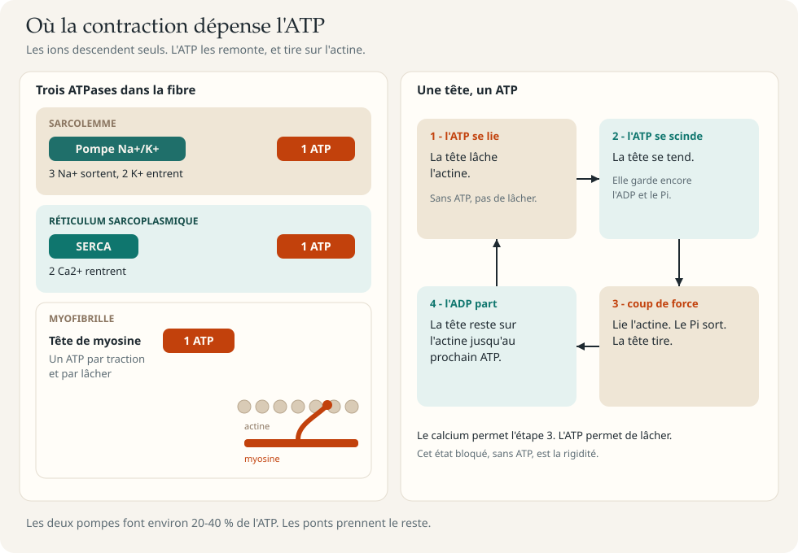
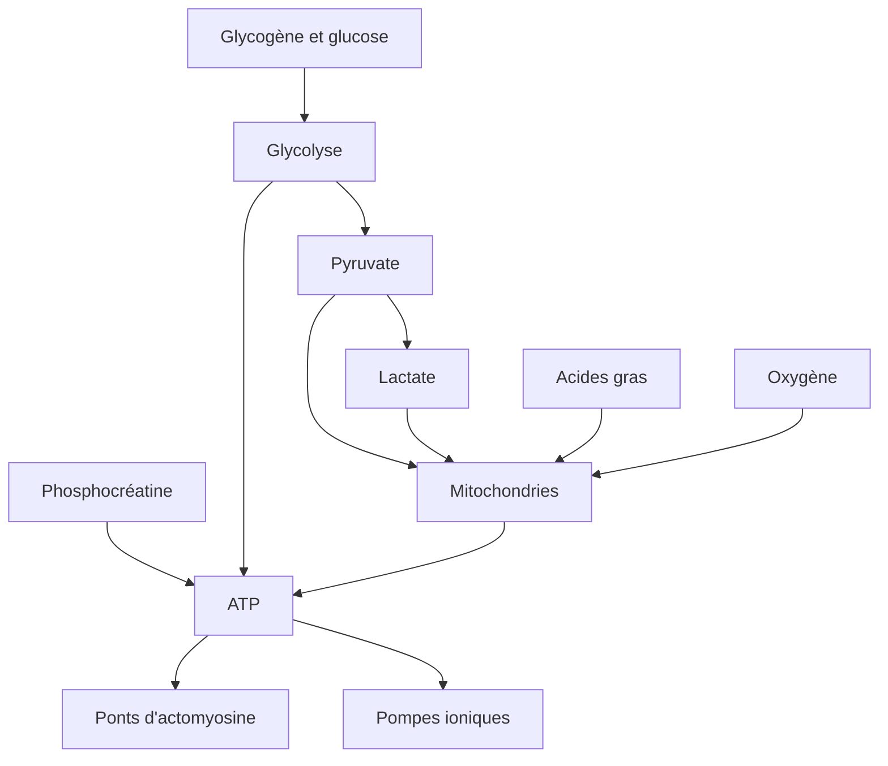

# Comment un cycliste produit l'énergie

Notes de cours. Première version, 14 novembre 2026.

Ces notes répondent à une question : quand les jambes tournent les pédales, d'où vient l'énergie, et pourquoi la réponse change entre un sprint de 10 secondes, un kilomètre, une côte et une longue étape ?

En bref, le muscle ne stocke presque pas la molécule qu'il dépense. Il la refait en continu, par trois voies qui se recouvrent. Elles ne s'allument pas et ne s'éteignent pas. L'intensité et la durée changent la part de chacune.

---

## 1. L'ATP est la monnaie, et le portefeuille est presque vide

Chaque contraction dépense de l'adénosine triphosphate (ATP). La tête de myosine s'en sert pour produire la force. La pompe sodium-potassium s'en sert pour restaurer la membrane après chaque potentiel d'action. La pompe à calcium (SERCA) s'en sert pour remettre le calcium dans le réticulum sarcoplasmique, afin que la fibre puisse se relâcher. Les pompes ioniques représentent une large part de la facture, de l'ordre de 20 à 40 % de l'ATP d'une contraction. Les ponts d'actomyosine prennent l'essentiel du reste.



<p class="figure-caption">Les trois ATPases d'une contraction, et le cycle qui dépense l'ATP de la myosine. La pompe sodium-potassium sort 3 Na+ et fait entrer 2 K+ par ATP. SERCA renvoie 2 Ca2+ dans le réticulum sarcoplasmique par ATP. Chaque tête de myosine utilise un ATP pour lâcher l'actine, se réarmer et tirer de nouveau. Le calcium décide si une traction est permise. L'ATP décide si la tête peut lâcher. Les deux pompes font ensemble environ 20 à 40 % de l'ATP. Les ponts prennent le reste.</p>

La réaction est :

```text
ATP + H2O → ADP + Pi + H+ + énergie
```

Le muscle au repos ne tient qu'environ 5 à 8 mmol d'ATP par kilogramme de muscle frais. Ce n'est pas une réserve d'énergie. C'est une concentration que la cellule défend, parce que l'énergie libre libérée en coupant l'ATP dépend d'un ATP haut et d'un ADP bas. Même à fond, l'ATP musculaire ne baisse en général que de 1 à 2 mmol/kg. S'il baisse beaucoup plus, la force s'effondre.

Hargreaves et Spriet chiffrent la vitesse à laquelle ce petit pool disparaîtrait si rien ne le remplaçait :

| Effort | Usage approximatif d'ATP | Durée de l'ATP stocké, seul |
| --- | --- | --- |
| Environ 200 W, près de 75 % de VO2max | ~0,4 mmol/kg/s | ~15 secondes |
| À fond, environ 900 W, près de 300 % de VO2max | ~3,7 mmol/kg/s | moins de 2 secondes |

Le renouvellement de l'ATP du muscle entier peut monter d'environ 100 fois entre le repos et un effort maximal. Certaines estimations des débits extrêmes vont plus haut encore. Pour le vélo, le point est plus simple : dès le premier coup de pédale, l'ATP doit être refait presque au rythme où il est dépensé.

Trois voies font ce travail.

1. Le système des phosphagènes : la phosphocréatine, plus une petite réaction de myokinase.
2. La glycolyse : dégradation du glucose ou du glycogène musculaire en pyruvate, et souvent en lactate.
3. La phosphorylation oxydative : les mitochondries oxydent les glucides et les lipides (et un peu d'acide aminé), ce qui demande de l'oxygène.

Les voies 1 et 2 sont des phosphorylations au niveau du substrat. Elles n'ont pas besoin d'oxygène, d'où le mot anaérobie. Ce mot ne veut pas dire que le muscle est privé d'oxygène. Il veut dire que la chimie elle-même n'utilise pas d'O2. La voie 3 utilise l'O2, apporté par la respiration et par le débit sanguin. La structure de cette voie, et pourquoi elle démarre lentement et choisit son carburant, est dans [Dans la mitochondrie](02-mitochondria.md).

---

## 2. Les trois voies diffèrent par la vitesse et par la taille

Deux mots comptent dans toutes ces notes.

- La **puissance** est le débit : combien de mmol d'ATP une voie peut refaire par seconde.
- La **capacité** est la quantité : combien d'ATP elle peut refaire avant que le substrat manque ou que les sous-produits forcent à ralentir.

Les voies rapides sont petites. La grande voie est plus lente à atteindre son plein débit.

| Voie | Substrat | Rendement net en ATP (ordre de grandeur) | Ce qui la limite |
| --- | --- | --- | --- |
| Phosphagènes | Phosphocréatine stockée dans la fibre | 1 ATP par PCr | Le stock lui-même. En grande partie parti en environ 10 s d'un vrai sprint maximal |
| Glycolyse jusqu'au lactate | Glycogène musculaire ou glucose sanguin | 3 ATP par unité glucosyle du glycogène ; 2 ATP par glucose sanguin | Le glycogène, la régulation des enzymes, et le trouble acido-basique qui s'accumule quand l'ATP est coupé plus vite qu'il n'est refait |
| Oxydation complète des glucides | Pyruvate issu du glycogène ou du glucose | Environ 30 ATP par glucose. Les vieux tableaux impriment ~36. L'entier dépend de l'ATP supposé par oxygène et de la navette qui porte le NADH glycolytique | L'apport d'oxygène, la capacité mitochondriale, et les stocks de glucides |
| Oxydation complète des lipides | Acides gras du tissu adipeux ou triglycérides intramusculaires | De l'ordre de 100 ATP par palmitate (lipide à 16 carbones). Les vieux tableaux impriment ~130 | Un débit plus bas que l'oxydation des glucides. Le lipide ne peut pas, seul, soutenir les intensités de course |

Les glucides donnent plus d'ATP par litre d'oxygène que les lipides. Un litre d'oxygène rend environ 21,1 kJ si le carburant est glucidique et environ 19,6 kJ s'il est lipidique. Les stocks de lipides sont énormes, même chez un coureur maigre. Les stocks de glucides ne le sont pas. C'est pourquoi la course est un problème de glucides bien avant d'être un problème de lipides.

Une image utile des rendements, avec les entiers classiques pour que la comparaison reste simple :

```text
PCr + ADP + H+  →  ATP + créatine                         (1 ATP)

unité de glycogène  →  2 lactate                          (~3 ATP)
glucose             →  2 lactate                          (~2 ATP)

glucose + O2    →  CO2 + H2O                              (~30–36 ATP)
palmitate + O2  →  CO2 + H2O                              (~100–130 ATP)
```

Le cyclisme ne transforme qu'environ 20 à 25 % de cette énergie métabolique en puissance aux pédales. Le reste est de la chaleur. Une longue sortie est autant un problème d'évacuation de chaleur qu'un problème de carburant, mais ce sera un autre cours.

---

## 3. Système des phosphagènes : le tampon du sprint, et aussi une navette

### La réaction

La créatine kinase siège sur la myofibrille, à côté de l'endroit où l'ATP est coupé :

```text
phosphocréatine + ADP + H+  →  créatine + ATP
```

La réaction est réversible, n'a pas besoin d'oxygène, et ne fait pas de lactate. Elle consomme aussi un proton, donc les premiers instants d'un effort dur peuvent légèrement alcaliniser la fibre avant que la glycolyse et l'hydrolyse de l'ATP ne poussent le pH dans l'autre sens.

La phosphocréatine de repos vaut plusieurs fois la concentration d'ATP. Un chiffre souvent utilisé est environ 20 à 26 mmol/kg de muscle frais, contre environ 5 à 8 mmol/kg pour l'ATP. Comme le stock est local et l'enzyme rapide, la phosphocréatine couvre les premiers coups de pédale d'un sprint.

### D'où vient la créatine, et où va l'excès

La réaction de la créatine kinase ne fabrique pas la créatine. Elle ne fait que déplacer un phosphate entre la créatine et l'ATP. Le pool total de créatine (créatine libre plus phosphocréatine) est à peu près fixe, donc sa taille se maintient en équilibrant ce qui entre et ce qui sort.

Ce qui entre :

- **L'alimentation.** La viande et le poisson sont les sources principales. Une alimentation mixte apporte environ 1 g par jour, et moins pour qui mange peu ou pas de viande.
- **La synthèse.** Le rein fabrique le guanidinoacétate à partir d'arginine et de glycine. Le foie ajoute un groupe méthyle, à partir de donneurs issus de la méthionine, pour faire la créatine. Ensemble, cela fait environ 1 g par jour.
- **La captation depuis le sang.** La créatine entre dans la fibre par un transporteur dépendant du sodium (SLC6A8) sur le sarcolemme. Environ 95 % de la créatine du corps, de l'ordre de 120 g chez un adulte de 70 kg, siège dans le muscle squelettique.

Ce qui sort :

- **La créatinine.** La créatine et la phosphocréatine perdent lentement et spontanément de l'eau pour former la créatinine, à environ 1,5 à 2 % du pool par jour. Le muscle ne peut pas retransformer la créatinine en créatine. Le rein la filtre dans l'urine. Comme le débit dépend de la masse musculaire, la créatinine urinaire sert de marqueur clinique de la masse musculaire et de la fonction rénale.
- **L'excès dans le sang.** La créatine que le muscle ne capte pas reste dans le plasma. Le rein la filtre et en récupère la plus grande part dans le tubule proximal. Elle n'apparaît dans l'urine que lorsque la créatine plasmatique dépasse cette capacité de récupération. C'est pourquoi une forte dose orale est en partie perdue dans l'urine.

Le muscle ne retient donc pas la créatine sans limite. Son niveau est fixé par un bilan : apports plus synthèse égalent captation musculaire plus perte en créatinine plus perte urinaire. Quand le muscle est proche de la saturation, le surplus reste dans le plasma et le rein l'élimine.

La stabilité de la réaction vient de l'enzyme, pas d'une créatine illimitée. La créatine kinase maintient le rapport phosphocréatine sur créatine proche de l'équilibre avec ATP sur ADP. Un rapport ATP/ADP haut favorise la phosphocréatine. Un rapport qui baisse la vide. Le rapport ne peut rester stable que si le pool total est suffisant. Le couple ATP/ADP décide comment le pool se partage entre phosphocréatine et créatine libre. Il ne remplace pas la créatine perdue en créatinine, et il n'empêche pas un surplus d'être excrété.

Une seconde réaction, beaucoup plus petite, est celle de la myokinase (adénylate kinase) :

```text
2 ADP → ATP + AMP
```

L'AMP, l'adénosine monophosphate, est un signal fort. Elle aide à allumer la dégradation du glycogène et l'étape engagée de la glycolyse (la phosphofructokinase). Si l'AMP monte encore, l'AMP désaminase la convertit en IMP (inosine monophosphate) et en ammoniac. Cette réaction ne fait pas d'ATP. Elle empêche la charge énergétique de la cellule de s'effondrer quand l'ATP commence à baisser.

### Quelle vitesse, et pendant combien de temps

Dans les efforts d'environ 10 secondes ou moins, les débits de pointe de resynthèse d'ATP par la phosphocréatine et par la glycolyse sont chacun de l'ordre de 6 à 9 mmol d'ATP par kilogramme de muscle sec et par seconde. Sur les 6 premières secondes d'un sprint, ils peuvent s'ajouter jusqu'à environ 15 mmol/kg de muscle sec/s, dont environ la moitié vient de la phosphocréatine. La dégradation de la phosphocréatine est la plus rapide à l'instant où la contraction commence, et elle baisse déjà après environ 1 à 2 secondes. La glycolyse met quelques secondes à atteindre son débit de pointe.

Pendant un sprint maximal, la phosphocréatine peut être en grande partie épuisée en environ 10 secondes. C'est pourquoi un sprint départ arrêté ou un dernier coup de cul ne peuvent pas être tenus à la puissance de pointe. Le stock est local aux fibres que l'on vient de recruter : un court effort des jambes ne vide pas la phosphocréatine d'un muscle inutilisé.

### La récupération est aérobie

La récupération, c'est le remplissage du stock de phosphocréatine. La réaction de la créatine kinase tourne à l'envers : la créatine prend un phosphate à l'ATP et redevient de la phosphocréatine.

```text
créatine + ATP  →  phosphocréatine + ADP
```

Chaque phosphocréatine rechargée coûte un ATP. Remettre le phosphate sur la créatine demande de l'ATP, et cet ATP vient surtout du métabolisme oxydatif. L'ATP propre du muscle est bas après un effort dur, donc les mitochondries paient le rechargement. C'est pourquoi le stock « anaérobie » est rechargé par le système aérobie, et pourquoi la consommation d'oxygène reste élevée pendant quelques minutes après l'exercice.

La récupération est biphasique :

- **Phase rapide.** Environ la moitié de la phosphocréatine perdue revient avec un temps de demi-vie de l'ordre de 20 à 30 secondes. La créatine kinase est rapide, et la créatine libre et l'ADP sont là pour la pousser.
- **Phase lente.** Le reste peut prendre plusieurs minutes. Il est limité par la vitesse à laquelle les mitochondries font l'ATP et par l'arrivée de l'oxygène. Une restauration presque complète prend souvent de moins de 5 minutes à plus de 15 minutes, selon la dureté de l'effort et selon la personne.

Le mécanisme des deux phases est encore discuté. Il faut prendre ceci comme l'interprétation courante, pas comme un résultat tranché.

Trois choses ralentissent le rechargement :

- **L'acidité.** Une fibre encore acide après le sprint se recharge plus lentement, parce qu'un pH bas ralentit la créatine kinase et la machinerie mitochondriale.
- **Le débit sanguin.** Quand l'apport sanguin du muscle est bloqué, par exemple avec un garrot dans les expériences, la phosphocréatine revient mal. C'est la preuve que l'oxygène donne le tempo.
- **Le type de fibre.** Les fibres rapides ont moins de capacité oxydative que les fibres lentes, donc elles se rechargent plus lentement.

Sur le vélo, un coureur qui reste au-dessus du seuil entre les efforts utilise les mitochondries pour tenir la puissance du moment. Il reste moins d'ATP de réserve pour recharger la phosphocréatine, donc l'attaque suivante part avec un stock plus petit. La limite est le temps dont le système aérobie a besoin pour restaurer le stock, pas une capacité fixe qui serait vidée pour de bon.

### Ce n'est pas seulement un carburant de sprint

En régime stable, les mitochondries font de l'ATP et la créatine kinase mitochondriale s'en sert pour recharger la créatine. La créatine et la phosphocréatine diffusent plus vite que l'ADP et l'ATP parce qu'elles sont plus petites, et leurs concentrations peuvent construire un gradient plus raide. La navette de la phosphocréatine est la façon dont le phosphate riche en énergie va des mitochondries aux myofibrilles pendant le travail aérobie. La phosphocréatine est à la fois le tampon d'urgence et le système de livraison.

---

## 4. Glycolyse : dégradation rapide des glucides, avec le lactate dans le plan

### Ce que fait la voie

La glycolyse, c'est dix étapes enzymatiques dans le cytosol. Le carburant est soit :

- le glucose sanguin, entré par les transporteurs GLUT4 et phosphorylé par l'hexokinase,
- soit une unité de glucose coupée du glycogène musculaire par la glycogène phosphorylase.

Partir du glycogène saute le premier ATP dépensé par l'hexokinase, donc le rendement net est de 3 ATP par unité glucosyle plutôt que 2 ATP par glucose sanguin, si la voie s'arrête au lactate. Cet écart de 50 % est la raison pour laquelle le glycogène musculaire, et non le glucose sanguin, nourrit les efforts les plus durs.

Le produit final de la glycolyse est le pyruvate, pas le lactate. Le pyruvate a deux destins.

- Entrer dans la mitochondrie, être converti par la pyruvate déshydrogénase en acétyl-CoA, et être oxydé.
- Être réduit en lactate par la lactate déshydrogénase, ce qui régénère le NAD+ dont la glycolyse a besoin pour continuer.

```text
pyruvate + NADH + H+  →  lactate + NAD+
```

Les deux destins ont lieu en même temps. « Glycolyse aérobie » et « glycolyse anaérobie » ne sont pas deux voies. Il y a une glycolyse. La différence, c'est ce qui arrive au pyruvate.

### Le lactate est un carburant et une soupape d'oxydoréduction, pas une impasse

Le lactate quitte la fibre par les transporteurs de monocarboxylates. D'autres fibres, le cœur et le muscle inactif peuvent l'oxyder. Le foie et les reins peuvent le retransformer en glucose (le cycle de Cori). Brooks a appelé cela la navette du lactate : le lactate est une façon de déplacer le carbone glucidique et le pouvoir réducteur d'une fibre qui produit du pyruvate vite vers un endroit qui peut l'oxyder.

Le lactate maintient aussi la glycolyse en vie. L'étape qui oxyde le glycéraldéhyde-3-phosphate a besoin de NAD+. Si le pyruvate n'était pas réduit en lactate, le NAD+ cytosolique chuterait et la glycolyse calerait en quelques secondes d'un effort dur. Sans production de lactate, un sprint maximal serait limité à la fenêtre de phosphocréatine d'environ 10 à 15 secondes.

La phrase d'école « l'acide lactique cause la brûlure » ne correspond pas à la chimie. La réaction de la lactate déshydrogénase consomme un proton. Les protons qui s'accumulent quand on va très fort viennent surtout de l'hydrolyse d'ATP qui n'est pas compensée par la resynthèse d'ATP, avec les déplacements d'ions forts. Le lactate est produit en même temps que ce trouble, donc le lactate sanguin reste un marqueur utile. Ce n'est pas l'acide.

### Ce qui allume la glycolyse

La glycogène phosphorylase est activée par le calcium libéré pour la contraction, par le phosphate inorganique issu de la coupure de l'ATP, et par l'adrénaline via l'AMP cyclique. La phosphofructokinase est accélérée par l'AMP et inhibée quand la fibre devient acide. La pyruvate déshydrogénase est activée par le calcium et par la montée du pyruvate, ce qui ouvre la porte des mitochondries même pendant qu'une partie du pyruvate devient encore du lactate.

Au début de l'exercice, la glycolyse tourne déjà. Elle n'attend pas que la phosphocréatine soit vide. Dans un effort maximal de 6 secondes, les biopsies montrent à peu près autant d'ATP venant de la phosphocréatine que du glycogène. À 30 secondes, la glycolyse a fourni environ trois fois plus d'ATP que la dégradation de la phosphocréatine.

### Pourquoi elle ne peut pas être le moteur d'un long effort

Le rendement par unité glucosyle est petit, donc un fort débit d'ATP mange le glycogène vite et produit le lactate vite. La glycolyse atteint son plus haut débit d'ATP vers 5 à 15 secondes d'un effort à fond, et peut encore contribuer largement pour des efforts allant jusqu'à quelques minutes. La plus grande capacité glycolytique, c'est-à-dire le plus grand total d'ATP par cette voie dans un effort épuisant, apparaît dans les efforts maximaux d'environ 2 à 3 minutes. Après cela, la puissance doit descendre à un débit que les mitochondries peuvent tenir.

---

## 5. Phosphorylation oxydative : le moteur de presque toutes les sorties qui comptent

Les mitochondries finissent le travail. Le pyruvate (des glucides) ou l'acétyl-CoA de la bêta-oxydation (des lipides) entre dans le cycle des acides tricarboxyliques. Le NADH et le FADH2 portent les électrons jusqu'à la chaîne respiratoire. L'oxygène est l'accepteur final. Le gradient de protons entraîne l'ATP synthase.

```text
glucides ou lipides + O2  →  CO2 + H2O + beaucoup d'ATP
```

Cette voie a la plus basse puissance et la plus grande capacité. Elle est plus lente à atteindre son plafond parce que l'apport d'oxygène, le débit sanguin et une longue chaîne d'enzymes doivent monter ensemble. Pour un saut brusque vers une forte puissance, la consommation d'oxygène a souvent besoin de l'ordre de deux minutes pour approcher sa nouvelle valeur stable, ou pour approcher VO2max si la puissance est assez haute. Ce retard est le déficit d'oxygène. La phosphocréatine et la glycolyse le couvrent. Un effort d'amorçage dur dans l'échauffement accélère la montée de la consommation d'oxygène pour un effort ultérieur, ce qui explique qu'une courte mise en route aide les épreuves de quelques minutes à environ 40 minutes.

Dès que l'effort dure plus d'environ une minute, l'oxydation est déjà le fournisseur majoritaire, même si l'effort est maximal. Le résumé de Gastin sur l'exercice maximal jusqu'à épuisement (plus bas) est le tableau le plus net pour cette affirmation.

### Oxydation des glucides

Le glycogène musculaire est le carburant glucidique dominant dès que l'intensité dépasse un moulinage facile. Le glucose sanguin devient plus important à mesure que la sortie avance et que le glycogène musculaire baisse. Le foie fournit ce glucose, d'abord en dégradant son propre glycogène, plus tard par néoglucogenèse à partir du lactate, du glycérol et de certains acides aminés. Le glycogène hépatique n'est que de l'ordre de 80 à 110 g. Le glycogène musculaire d'un coureur entraîné et bien nourri se compte en plusieurs centaines de grammes, et c'est le stock qui décide vraiment si une longue sortie dure survit. Le glucose sanguin lui-même n'est que de quelques grammes : c'est un flux de livraison, pas un réservoir.

À intensité modérée, le muscle au travail capte la plus grande part du glucose que le foie libère. Dans une sortie alimentée, les glucides venus de l'intestin rejoignent ce flux. Les glucides ingérés n'épargnent pas entièrement le glycogène musculaire, mais ils maintiennent la glycémie et l'oxydation des glucides après que la production hépatique aurait baissé, et ils retardent la fatigue dans les longs efforts.

### Oxydation des lipides

Les acides gras viennent de deux endroits : le tissu adipeux (acides gras libres du plasma) et des gouttelettes dans la fibre (triglycérides intramusculaires). Faire entrer un acide gras à longue chaîne dans la mitochondrie demande la navette de la carnitine. Cette étape est un point de contrôle, et c'est une raison pour laquelle l'oxydation des lipides baisse quand la glycolyse tourne fort : la machinerie est occupée par les glucides, et l'entrée des acides gras est inhibée.

Le schéma avec l'intensité est le même d'une étude à l'autre avec des traceurs :

- À basse intensité, les lipides fournissent la plus grande part de l'énergie. Les acides gras plasmatiques font l'essentiel de ce travail.
- L'oxydation absolue des lipides, en grammes par minute, culmine vers 60 à 65 % de VO2max chez les personnes entraînées. Cette intensité est souvent appelée FatMax. C'est une observation métabolique, pas une prescription de zone d'entraînement.
- Au-dessus, l'oxydation des lipides baisse alors que la demande d'énergie totale continue de monter. Les glucides, surtout le glycogène musculaire, prennent le relais.
- Perfuser des lipides pour que les acides gras plasmatiques restent hauts ne restaure pas l'oxydation des lipides à haute intensité. La limite est dans le muscle, pas seulement dans la livraison.

Avec la durée, à une puissance sous-maximale stable, l'usage du glycogène musculaire ralentit, les acides gras plasmatiques montent, et les lipides couvrent une part croissante. Ce glissement est la raison pour laquelle la dernière heure d'une longue sortie se sent différente de la première sur le plan métabolique, et pourquoi cela s'effondre si les glucides sont déjà bas.

### Acides aminés

Les acides aminés sont un vrai carburant et une vraie source d'azote que le foie doit éliminer en urée, mais ils sont une petite fraction de l'ATP dans une sortie normalement alimentée, bien sous 10 % et souvent seulement quelques pourcents. La part monte si le glycogène est bas et la sortie longue. Ce n'est pas un troisième moteur sur lequel on pourrait compter en s'entraînant.

### Quotient respiratoire, et où il ment

Le rapport du dioxyde de carbone expiré à l'oxygène inspiré (QR) vaut environ 0,7 pour une oxydation pure de lipides et 1,0 pour une oxydation pure de glucides. C'est une moyenne de tout le corps, et il surestime l'usage des glucides dès que l'effort est assez dur pour que le bicarbonate tamponne l'acide, parce que ce tamponnage libère du CO2 en plus. Au-dessus du point où le lactate monte de façon continue, il ne faut pas lire le QR comme une répartition nette des carburants.

---

## 6. Elles tournent ensemble : efforts maximaux selon la durée

L'image du manuel où la phosphocréatine fait 0 à 10 secondes, la glycolyse 10 à 60 secondes, et l'oxygène tout le reste, est fausse. Elle survit parce que la voie *dominante* change avec la durée. La voie *exclusive* n'existe pas.

Deux jeux de chiffres valent d'être gardés. Ils ne coïncident pas au point de pourcentage près, parce que l'un vient de biopsies musculaires sur un sprint de 30 secondes et l'autre est une courbe ajustée sur beaucoup d'études d'exercice jusqu'à épuisement. Les deux sont des estimations, avec une incertitude d'environ ±10 points de pourcentage.

**Dans un seul sprint court** (biopsie et modélisation ; Baker, McCormick et Robergs, à partir de plusieurs laboratoires) :

| Sprint maximal | Phosphagènes | Glycolyse | Oxydatif |
| --- | --- | --- | --- |
| Environ 10 s | ~50 % | ~45 % | quelques pourcents |
| Environ 30 s | ~25 % | ~50 % | ~25–30 % |

Un sprint de 30 secondes vers le panneau du village est déjà aérobie pour un quart à un tiers. La revue cycliste de Faria donne une répartition voisine à 30 secondes : glycolyse environ 50 à 55 %, phosphocréatine environ 23 à 29 %, oxydation environ 16 à 25 %.

**Contribution cumulée sur un effort maximal tenu jusqu'à épuisement** (Gastin, 2001, estimation groupée) :

| Durée | Anaérobie (PCr + glycolyse) | Aérobie |
| --- | --- | --- |
| 10 s | 94 % | 6 % |
| 30 s | 73 % | 27 % |
| 60 s | 55 % | 45 % |
| 75 s | 49 % | 51 % |
| 90 s | 44 % | 56 % |
| 2 min | 37 % | 63 % |
| 3 min | 27 % | 73 % |
| 4 min | 21 % | 79 % |

Le croisement, où les apports aérobie et anaérobie sont égaux, se situe vers 75 secondes, pas vers 2 à 4 minutes comme les vieux manuels le disaient. Ces vieux chiffres utilisaient la dette d'oxygène comme mesure de l'énergie anaérobie, et la dette d'oxygène la surestime.

Dans un même effort dur, les parts bougent aussi. En 90 secondes de cyclisme à fond, la part aérobie de chaque demi-minute est d'environ 30 % dans les 30 premières secondes, environ 70 % de 30 à 60 secondes, et environ 90 % de 60 à 90 secondes. On va toujours très fort. Le moteur en dessous a changé.

Sur un second sprint de 30 secondes, après quelques minutes de récupération, la part aérobie est de nouveau plus grande (environ 40 % dans une étude connue) parce que la resynthèse anaérobie d'ATP n'a pas entièrement récupéré et que la consommation d'oxygène est déjà élevée. Les relances répétées deviennent un problème aérobie même si chaque relance se sent anaérobie.



---

## 7. Quand l'effort n'est pas maximal : l'intensité décide du carburant

Pour toute sortie que l'on pourrait tenir plus de quelques minutes, presque tout l'ATP est oxydatif. La question intéressante devient : quel carburant les mitochondries brûlent-elles ?

| Intensité stable | Ce qui domine en général | Pourquoi cela compte sur le vélo |
| --- | --- | --- |
| Moulinage facile, bien sous le seuil | Lipides, surtout les acides gras plasmatiques. Un peu de glucides | Carburant presque illimité. C'est là que se placent les longues sorties de fond |
| Vers 60–65 % de VO2max | Plus haute oxydation absolue des lipides, avec déjà une large part de glucides | FatMax. Encore très loin de l'allure de course d'un coureur entraîné |
| Autour du seuil et au-dessus | Glycogène musculaire, avec une part croissante de glucose sanguin quand la durée s'allonge | Les intensités qui décident les courses. Le glycogène est fini |
| À fond, de quelques secondes à environ 2 min | Phosphocréatine et glycolyse par-dessus une contribution oxydative qui monte vite | La puissance est haute parce que les voies rapides s'ajoutent à l'oxydation. Elles se vident |

À 60–70 % de VO2max, pour des efforts de moins d'une heure, on a estimé que le glycogène musculaire couvre environ 35 à 70 % de l'énergie, selon l'étude et la méthode. Vers deux heures à une intensité voisine, la part du glycogène baisse (vers ~20 % dans certaines données) et les acides gras plasmatiques et le glucose sanguin comptent davantage. Si le glycogène est très bas, la puissance du haut de la plage s'effondre : on peut encore rouler, mais on ne peut plus tenir l'intensité qui demandait l'oxydation des glucides.

L'entraînement déplace cela. À la même puissance absolue, un muscle entraîné en endurance utilise moins de glucides et plus de lipides, parce qu'il a plus de mitochondries et un apport sanguin plus riche. À une intensité de course exprimée en pourcentage du maximum de ce coureur, les glucides restent le carburant qui fixe l'allure.

### La même idée sur une échelle de puissance : les zones ESIE

L'entraînement français utilise l'échelle ESIE de Frédéric Grappe (échelle subjective de l'intensité de l'effort). Elle découpe la puissance en sept zones, en pourcentage de la PMA, la puissance maximale aérobie. En pratique, la PMA est la meilleure puissance moyenne sur environ 5 minutes (4 à 6 minutes est accepté). En théorie, c'est la puissance à VO2max, mais un test de 5 minutes puise aussi dans le système lactique, donc la PMA est une approximation.

| Zone ESIE | % de PMA | Carburant et ressenti, tels que ces notes les décrivent |
| --- | --- | --- |
| I1, récupération | 40–50 % | Les lipides portent presque tout. Tolérance de plusieurs heures. Conversation facile |
| I2, endurance | 50–60 % | Surtout des lipides, avec peu de fatigue. Le premier seuil (SV1) est près du haut de cette bande. La zone des longues sorties de fond |
| I3, tempo | 60–75 % | Entre les deux seuils. L'usage des glucides monte et la fatigue s'accumule. La respiration est gênée |
| I4, seuil | 75–85 % | Autour du second seuil (SV2). L'usage du glycogène est haut, et le lactate monte vite au-dessus. La conversation est difficile |
| I5, PMA | 85–100 % | Près de VO2max, oxydation et glycolyse tournant fort toutes les deux. Tolérance d'environ 5 à 10 minutes |
| I6 | environ 110–180 % (les sources diffèrent) | Efforts d'environ 30 secondes à une minute. La glycolyse domine |
| I7 | maximale, 1–10 secondes | Sprint. La phosphocréatine domine |

Deux précautions. Les pourcentages sont des moyennes de population, et les seuils d'une personne peuvent se situer quelques points de part et d'autre. Les bandes diffèrent aussi un peu selon les échelles publiées : la même bande I3 est imprimée 60–70 % dans certains tableaux et 60–75 % dans d'autres. Il faut s'en servir pour ordonner les zones, et confirmer ses propres seuils par un test.

Sur cette échelle, FatMax (environ 60 à 65 % de VO2max) tombe près du haut de I2 et du début de I3. C'est pourquoi les longues sorties d'endurance pour l'usage des lipides se placent en I2, et pourquoi I3 demande déjà plus de glucides qu'une longue sortie n'en a besoin.

---

## 8. Ce que cela donne dans le cyclisme réel

Ce sont des traductions des tableaux ci-dessus, pas une physiologie séparée.

| Situation | Durée et intensité | Ce qui porte l'ATP |
| --- | --- | --- |
| Sprint assis depuis une faible vitesse, ou départ arrêté | Puissance de pointe dans les 5 à 10 premières s | Phosphocréatine et glycolyse ensemble dès les premières secondes. L'oxydation est quelques pourcents du total |
| Sprint à fond tenu ~30 s | Effort de type Wingate | La glycolyse est la plus grande part isolée. L'oxydation est déjà d'un quart à un tiers |
| Kilo, ou court pont | ~60 s maximal | Proche de moitié-moitié. La seconde moitié de l'effort est surtout aérobie même si cela fait mal |
| Poursuite, courte côte, longue attaque | ~3–5 min maximal | Environ trois quarts à quatre cinquièmes aérobie. La part anaérobie explique pourquoi ce n'est pas un état stable |
| Contre-la-montre, longue côte | Dizaines de minutes, près de la plus haute puissance stable | Presque tout oxydatif, dominé par les glucides. De petites dérives de la consommation d'oxygène puisent encore dans le travail fini que l'on peut faire au-dessus de la puissance critique |
| Étape | Des heures, surtout sous le seuil, avec des à-coups | Oxydatif tout le temps. Les lipides portent les passages faciles. Chaque accélération et chaque long relais dépense du glycogène qui n'est pas remplacé avant de manger et de récupérer |
| Sprint à l'arrivée après s'être caché dans les roues | 10–15 s, si les minutes précédentes étaient sous le seuil | La phosphocréatine a été rechargée par l'ATP oxydatif pendant l'abri. C'est le sens de se cacher |

Deux conséquences pratiques en découlent.

D'abord, le système aérobie décide plus d'efforts courts que les coureurs ne le pensent en général. Un kilo n'est pas un test anaérobie avec un peu d'oxygène à côté. Une poursuite est une épreuve aérobie qui fait mal parce qu'on est au-dessus de la puissance où le métabolisme peut se stabiliser.

Ensuite, la phosphocréatine entre les efforts est un problème de récupération aérobie. Rester au-dessus du seuil, et la relance suivante est plus faible, même si la relance elle-même sera alimentée par la phosphocréatine et la glycolyse.

---

## 9. La frontière qui compte dès que la sortie dépasse quelques minutes

VO2max est le plafond de la resynthèse oxydative d'ATP : le plus haut débit auquel les poumons, le cœur, le sang et les mitochondries peuvent utiliser l'oxygène. Il fixe la puissance aérobie haute. Il ne dit pas quelle part de ce plafond on peut occuper.

La puissance critique (CP) est la meilleure frontière pour le cyclisme. C'est l'asymptote de la courbe puissance-durée. Au-dessus de CP, l'épuisement arrive à un temps prédit, en première approximation, par :

```text
temps jusqu'à la limite = W′ / (puissance − CP)
```

W′ est une quantité finie de travail au-dessus de CP, en joules. Ce n'est pas un réservoir de lactate, et ce n'est pas « la capacité anaérobie » au sens propre. Dépenser W′ puise dans la phosphocréatine, dans la glycolyse au-delà de ce que l'oxydation peut égaler, dans les petits stocks d'oxygène de l'hémoglobine et de la myoglobine, et dans le fait que les processus de fatigue s'accumulent. Sous CP, ces comptes peuvent se stabiliser. Au-dessus de CP, non : la consommation d'oxygène monte vers VO2max, le lactate sanguin monte sans plateau, et on s'arrête quand W′ est dépensé.

Chez de jeunes adultes en bonne santé, le premier seuil lactique ou d'échanges gazeux se situe souvent vers 50 à 65 % de VO2max, et la puissance critique vers 70 à 80 %. Chez les cyclistes bien entraînés, les deux montent ; la puissance critique peut se situer vers 80 à 90 % de VO2max. Ces pourcentages sont des plages typiques, pas des seuils diagnostiques. CP et l'état stable maximal de lactate sont proches et sont parfois traités comme le même repère. Ils se mesurent différemment et ne sont pas identiques en watts.

Pour ces notes, la lecture métabolique suffit :

- Sous le premier seuil, l'oxydation des lipides et des glucides égale la demande et le lactate reste près des niveaux de repos.
- Entre le premier seuil et CP, l'oxydation atteint encore un état stable, mais avec une plus grande part de glucides et un lactate élevé et stable.
- Au-dessus de CP, les voies rapides ne sont plus un emprunt bref de démarrage. Elles sont un découvert continu, et la sortie a une fin prévisible.

---

## 10. Des idées fausses qui valent d'être rangées

**Les systèmes se relaient.** Ils sont tous actifs presque tout de suite. Un sprint de 10 secondes utilise déjà la glycolyse à une part proche de celle de la phosphocréatine. Un effort maximal de 60 secondes est presque à moitié aérobie.

**« Anaérobie » veut dire que le muscle n'a pas d'oxygène.** Cela veut dire que la voie ne consomme pas d'oxygène. Le lactate apparaît parce que le pyruvate est fabriqué plus vite que les mitochondries ne le prennent, ce qui arrive à fort flux glycolytique même quand l'apport d'oxygène est normal.

**Le lactate est un déchet qui cause la fatigue.** La formation du lactate régénère le NAD+, consomme un proton, et passe des glucides à d'autres cellules. La fatigue des efforts durs suit plus directement la déplétion de phosphocréatine, le phosphate inorganique, les ions hydrogène, les déplacements de potassium et la perte de glycogène que la concentration de lactate elle-même. Le lactate sanguin reste un marqueur commode de l'intensité à laquelle la voie glycolytique tourne par rapport à son élimination.

**Une longue sortie lente est alimentée comme une course, en plus lent.** Le roulage facile est un mélange lipides plus glucides. L'allure de course est un effort glucidique. Ce croisement est la raison pour laquelle l'entraînement à glycogène bas change certaines adaptations, et aussi pourquoi il émousse la qualité du travail à haute intensité.

**W′ est un réservoir anaérobie séparé que l'on vide et que l'on recharge comme une jauge de batterie.** Il se comporte un peu ainsi dans le modèle, ce qui explique que les capteurs de puissance puissent l'estimer. Physiologiquement, c'est le travail que l'on peut faire pendant que le muscle est au-dessus du plus haut état stable oxydatif, et son rechargement dépend de combien on est sous CP, et pendant combien de temps.

---

## 11. Quelques chiffres qui valent d'être retenus

- ATP stocké : ~5–8 mmol/kg de muscle frais, bon pour moins de 2 secondes à fond, ou ~15 secondes à une forte puissance sous-maximale, si rien d'autre n'aidait.
- Phosphocréatine : plusieurs fois le stock d'ATP, en grande partie utilisée en ~10 secondes d'un sprint maximal, restaurée par l'ATP oxydatif en quelques minutes.
- Rendement glycolytique net : 3 ATP par unité de glycogène, 2 ATP par glucose sanguin, quand le produit est le lactate.
- Rendement oxydatif : un ordre de grandeur de plus d'ATP par unité de glucide, à un débit plus bas.
- Contribution aérobie et anaérobie égales pendant un exercice maximal : vers 75 secondes.
- Un sprint de 30 secondes : déjà ~25–30 % oxydatif.
- Un effort maximal de 4 minutes : ~80 % oxydatif.
- Pic d'oxydation des lipides : vers 60–65 % de VO2max. Au-dessus, les glucides prennent le relais.
- Rendement brut du cyclisme : environ 20–25 %. La plus grande part de l'énergie de l'ATP devient de la chaleur.

---

## 12. Questions à garder pour les prochaines notes

- Comment l'oxygène va de l'air aux crêtes, et quelle étape limite VO2max une fois la machinerie de [Dans la mitochondrie](02-mitochondria.md) en place.
- Ce qui change dans chaque voie avec l'entraînement d'endurance par rapport à l'entraînement de sprint.
- La déplétion du glycogène, l'apport de glucides, et pourquoi la même puissance peut sembler facile à la première heure et impossible à la quatrième.
- De quoi W′ est fait, et à quelle vitesse il revient entre les intervalles.
- Pourquoi le seuil lactique, l'état stable maximal de lactate et la puissance critique sont liés et ne sont toujours pas la même puissance.

---

## Sources

Les chiffres ci-dessus viennent de ces revues et des études qu'elles résument. Quand deux méthodes divergent d'environ 10 points de pourcentage, les notes le disent au lieu de choisir une fausse précision.

- Hargreaves M, Spriet LL. Exercise metabolism: fuels for the fire. *Cold Spring Harbor Perspectives in Medicine*. 2018. [PMC](https://pmc.ncbi.nlm.nih.gov/articles/PMC6071548/). Pool d'ATP, les exemples à 200 W et 900 W, la part oxydative de 25 à 30 % d'un effort maximal de 30 secondes, et le pic d'oxydation des lipides à 60–65 % de VO2max.
- Hargreaves M, Spriet LL. Skeletal muscle energy metabolism during exercise. *Nature Metabolism*. 2020. [doi:10.1038/s42255-020-0251-4](https://doi.org/10.1038/s42255-020-0251-4). Le cadre intensité-durée, et l'idée que les glucides sont le carburant de la plupart des épreuves.
- Baker JS, McCormick MC, Robergs RA. Interaction among skeletal muscle metabolic energy systems during intense exercise. *Journal of Nutrition and Metabolism*. 2010. [PMC3005844](https://pmc.ncbi.nlm.nih.gov/articles/PMC3005844/). Stock de phosphocréatine, les répartitions à 10 et 30 secondes, le lactate comme régénération du NAD+ plutôt que comme acide sans issue, et l'alcalinisation par la créatine kinase au début de l'exercice.
- Gastin PB. Energy system interaction and relative contribution during maximal exercise. *Sports Medicine*. 2001;31:725–741. [PubMed 11547894](https://pubmed.ncbi.nlm.nih.gov/11547894/). Le tableau de durée de 10 secondes à 4 minutes, le croisement vers 75 secondes, et les parts successives dans un effort à fond de 90 secondes. Bande de prédiction d'environ ±10 points.
- Faria EW, Parker DL, Faria IE. The science of cycling: physiology and training, part 1. *Sports Medicine*. 2005. La répartition à 30 secondes utilisée dans la littérature cycliste (glycolyse ~50–55 %, phosphocréatine ~23–29 %, oxydation ~16–25 %).
- Axsom JE, Arany Z. What do we know of human fuel use during aerobic exercise, and how do we know it? *Physiology*. 2025. [PMC12375902](https://pmc.ncbi.nlm.nih.gov/articles/PMC12375902/). Résultat de biopsie à six secondes, glycolyse contre phosphocréatine à 30 secondes, part du glycogène à 60–70 % de VO2max, et les limites du QR.
- Romijn JA et al. Regulation of endogenous fat and carbohydrate metabolism in relation to exercise intensity and duration. *American Journal of Physiology*. 1993. La carte classique intensité-durée des carburants, que les revues ultérieures dessinent encore.
- van Loon LJC et al. The effects of increasing exercise intensity on muscle fuel utilisation in humans. *Journal of Physiology*. 2001.
- Poole DC, Burnley M, Vanhatalo A, Rossiter HB, Jones AM. Critical power: an important fatigue threshold in exercise physiology. *Medicine & Science in Sports & Exercise*. 2016. [PMC5070974](https://pmc.ncbi.nlm.nih.gov/articles/PMC5070974/). CP comme frontière lourd/sévère, l'équation du temps limite, et la place de CP par rapport à VO2max.
- Grappe F. Tests de mesure de l'aptitude physique (document de test de 2006, avec les bandes ESIE en % de PMA). [PDF](https://www.fredericgrappe.com/wp-content/uploads/2013/06/testsevaluation.pdf). La définition de la PMA et les descriptions I1 à I7 de la section ESIE.
- Deutsch R. Mieux comprendre l'échelle d'ESIE de Frédéric Grappe. Lepape-Info, 2021. [article](https://www.lepape-info.com/entrainement/entrainement-cyclisme/mieux-comprendre-lechelle-desie-de-frederic-grappe/). La convention de PMA sur 5 minutes, les bandes de pourcentage ESIE, et l'avertissement que ce sont des moyennes de population.
- Wyss M, Kaddurah-Daouk R. Creatine and creatinine metabolism. *Physiological Reviews*. 2000;80(3):1107–1213. Synthèse dans le rein et le foie, apport alimentaire, captation musculaire par SLC6A8, et conversion non enzymatique en créatinine. Source du paragraphe sur le bilan de créatine, section 3.
- MacIntosh BR. Energy supply for exercise. *Open Textbook of Exercise Physiology*, Université de Calgary. [Chapitre 6A](https://pressbooks.openeducationalberta.ca/otep/chapter/chapter-6a-energy-supply-for-exercise/). Navette de la créatine, rendement brut, et équivalent énergétique d'un litre d'oxygène.
- Brooks GA. La navette du lactate. Des revues ultérieures dans le *Journal of Physiology* (2009) résument la même idée : le lactate comme carburant déplacé entre les cellules, pas comme un déchet.
- Coyle EF et al. Carbohydrate feeding during prolonged strenuous exercise can delay fatigue. *Journal of Applied Physiology*. 1983. Et Coggan AR, Coyle EF, 1987, sur le fait de renverser la fatigue avec des glucides tard dans l'exercice.
