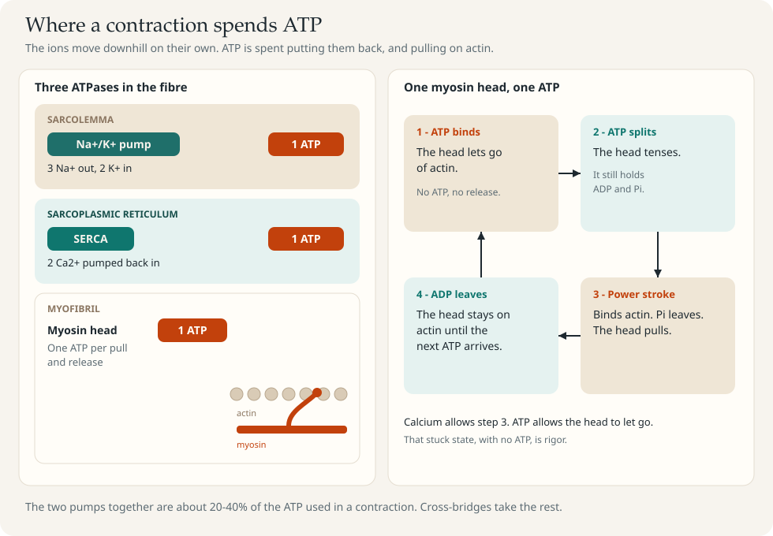
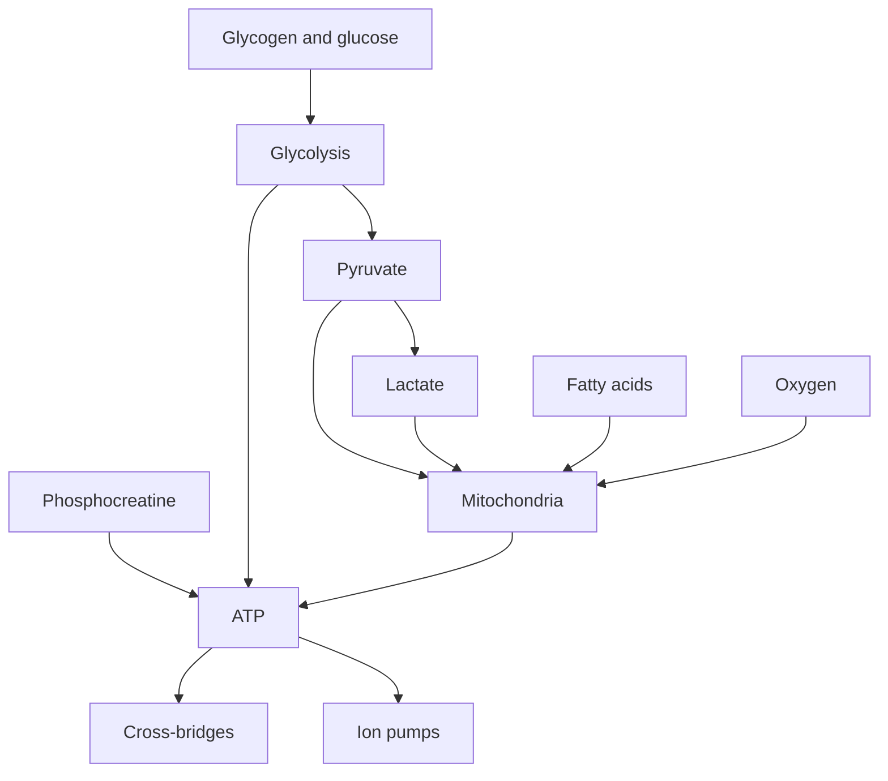

# How a cyclist makes energy

Lecture notes. First pass, 14 November 2026.

These notes are about one question: when the legs turn the pedals, where does the energy come from, and why does the answer change between a 10-second sprint, a kilo, a climb, and a long road stage?

The short version is that muscle never stores much of the molecule it actually spends. It remakes that molecule, continuously, by three overlapping pathways. They do not switch on and off. Intensity and duration change the share each one carries.

---

## 1. ATP is the currency, and the wallet is almost empty

Every contraction spends adenosine triphosphate (ATP). The myosin head uses it to produce force. The sodium–potassium pump uses it to restore the membrane after each action potential. The calcium pump (SERCA) uses it to put calcium back into the sarcoplasmic reticulum so the fibre can relax. Ion pumping is a large fraction of the bill, on the order of 20–40% of the ATP used in a contraction; the cross-bridges take most of the rest.



<p class="figure-caption">The three ATPases of one contraction, and the cycle that spends the myosin ATP. The sodium–potassium pump moves 3 Na+ out and 2 K+ in per ATP. SERCA returns 2 Ca2+ to the sarcoplasmic reticulum per ATP. Each myosin head uses one ATP to let go of actin, recock, and pull again. Calcium decides whether a pull is allowed; ATP decides whether the head can let go. The two pumps together are about 20–40% of the ATP. The cross-bridges take the rest.</p>

The reaction is:

```text
ATP + H2O → ADP + Pi + H+ + energy
```

Resting muscle holds only about 5–8 mmol of ATP per kilogram of wet muscle. That is not an energy reserve. It is a concentration the cell tries to defend, because the free energy released by splitting ATP depends on keeping ATP high and ADP low. Even in all-out exercise, muscle ATP usually falls by only 1–2 mmol/kg. If it falls much further, force collapses.

Hargreaves and Spriet put numbers on how fast that small pool would vanish if nothing replaced it:

| Effort | Rough ATP use | How long stored ATP would last alone |
| --- | --- | --- |
| About 200 W, near 75% of VO2max | ~0.4 mmol/kg/s | ~15 seconds |
| All-out, around 900 W, near 300% of VO2max | ~3.7 mmol/kg/s | under 2 seconds |

Whole-muscle ATP turnover can rise about 100-fold from rest to a maximal effort. Some estimates for the most extreme rates go higher still. The point for cycling is simpler: from the first pedal stroke, ATP has to be remade at almost the same rate it is used.

Three pathways do that work.

1. The phosphagen system: phosphocreatine, plus a small myokinase reaction.
2. Glycolysis: breakdown of glucose or muscle glycogen to pyruvate, and often to lactate.
3. Oxidative phosphorylation: mitochondria oxidizing carbohydrate and fat (and a little amino acid), which requires oxygen.

Pathways 1 and 2 are substrate-level phosphorylation. They do not need oxygen, which is why they are called anaerobic. That word does not mean the muscle is out of oxygen. It means the chemistry itself does not use O2. Pathway 3 does use O2, delivered by breathing and by blood flow. The structure of that pathway, and why it is slow to start and choosy about fuel, is [Inside the mitochondrion](02-mitochondria.md).

---

## 2. The three pathways differ in speed and in size

Two words matter all the way through these notes.

- **Power** is the rate: how many mmol of ATP a pathway can remake per second.
- **Capacity** is the amount: how much ATP it can remake before its substrate runs out or its by-products force you to slow down.

The fast pathways are small. The large pathway is slower to reach full rate.

| Pathway | Substrate | Net ATP yield (order of magnitude) | What limits it |
| --- | --- | --- | --- |
| Phosphagen | Phosphocreatine stored in the fibre | 1 ATP per PCr | The store itself. Mostly gone within about 10 s of a true maximal sprint |
| Glycolysis to lactate | Muscle glycogen or blood glucose | 3 ATP per glucosyl unit from glycogen; 2 ATP per blood glucose | Glycogen, enzyme regulation, and the acid–base disturbance that builds when ATP is split faster than it is remade |
| Full oxidation of carbohydrate | Pyruvate from glycogen or glucose | Roughly 30 ATP per glucose. Older tables print ~36. The integer depends on the assumed ATP per oxygen and on which shuttle carries glycolytic NADH | Oxygen delivery, mitochondrial capacity, and carbohydrate stores |
| Full oxidation of fat | Fatty acids from adipose tissue or intramuscular triglyceride | On the order of 100 ATP per palmitate (16-carbon fat). Older tables print ~130 | A lower rate than carbohydrate oxidation. Fat cannot support race intensities on its own |

Carbohydrate gives more ATP per litre of oxygen than fat. One litre of oxygen yields about 21.1 kJ if carbohydrate is the fuel and about 19.6 kJ if fat is the fuel. Fat stores are enormous even in a lean rider. Carbohydrate stores are not. That is why racing is a carbohydrate problem long before it is a fat problem.

A useful picture of the yields, using the classical integers so the comparison stays easy:

```text
PCr + ADP + H+  →  ATP + creatine                         (1 ATP)

glycogen unit   →  2 lactate                              (~3 ATP)
glucose         →  2 lactate                              (~2 ATP)

glucose + O2    →  CO2 + H2O                              (~30–36 ATP)
palmitate + O2  →  CO2 + H2O                              (~100–130 ATP)
```

Cycling turns only about 20–25% of that metabolic energy into power at the pedals. The rest is heat. A long ride is as much a heat-dissipation problem as a fuel problem, but that is a later lecture.

---

## 3. Phosphagen system: the sprint buffer, and also a shuttle

### The reaction

Creatine kinase sits on the myofibril, next to where ATP is split:

```text
phosphocreatine + ADP + H+  →  creatine + ATP
```

The reaction is reversible, needs no oxygen, and makes no lactate. It also consumes a proton, so the first moments of hard exercise can slightly alkalinize the fibre before glycolysis and ATP hydrolysis push pH the other way.

Resting phosphocreatine is several times the ATP concentration. A figure often used is about 20–26 mmol/kg wet muscle, against about 5–8 mmol/kg for ATP. Because the store is local and the enzyme is fast, phosphocreatine covers the first pedal strokes of a sprint.

### Where the creatine comes from, and where the excess goes

The creatine kinase reaction does not make creatine. It only moves a phosphate between creatine and ATP. The total creatine pool (free creatine plus phosphocreatine) is roughly fixed, so the pool has to be kept at its size by balancing what comes in against what leaves.

What comes in:

- **Diet.** Meat and fish are the main sources. A mixed diet supplies roughly 1 g a day, and less for people who eat little or no meat.
- **Synthesis.** The kidney makes guanidinoacetate from arginine and glycine. The liver adds a methyl group, using methionine-derived methyl donors, to make creatine. Together this is roughly 1 g a day.
- **Uptake from the blood.** Creatine enters the fibre through a sodium-dependent transporter (SLC6A8) on the sarcolemma. About 95% of the body's creatine, on the order of 120 g in a 70 kg adult, sits in skeletal muscle.

What leaves:

- **Creatinine.** Creatine and phosphocreatine slowly and spontaneously lose water to form creatinine, at roughly 1.5–2% of the pool per day. Muscle cannot turn creatinine back into creatine. The kidney filters it into the urine. Because the rate depends on muscle mass, creatinine output is used as a clinical marker of muscle mass and kidney function.
- **Excess in the blood.** Creatine that the muscle does not take up stays in the plasma. The kidney filters it and reclaims most of it in the proximal tubule. It appears in urine only when plasma creatine is high enough to exceed that reclaiming capacity. This is why a large oral dose is partly lost in urine.

The muscle therefore does not hold creatine without limit. Its level is set by a balance: intake plus synthesis equals muscle uptake plus creatinine loss plus urinary loss. When the muscle is close to saturation, the extra creatine stays in plasma and is cleared by the kidney.

The stability of the reaction comes from the enzyme, not from unlimited creatine. Creatine kinase keeps phosphocreatine to creatine close to equilibrium with ATP to ADP. A high ATP to ADP ratio favours phosphocreatine. A falling ratio drains it. The ratio can be steady only while the total pool is adequate. The ATP/ADP couple decides how the pool is split between phosphocreatine and free creatine. It does not replace creatine that has been lost as creatinine, and it does not stop a surplus from being excreted.

A second, much smaller reaction is the myokinase (adenylate kinase) reaction:

```text
2 ADP → ATP + AMP
```

AMP is a loud signal. It helps turn on glycogen breakdown and the committed step of glycolysis (phosphofructokinase). If AMP rises further, AMP deaminase converts it to IMP and ammonia. That reaction does not make ATP. It keeps the energy charge of the cell from collapsing when ATP starts to fall.

### How fast, and for how long

In efforts of about 10 seconds or less, peak rates of ATP resynthesis from phosphocreatine and from glycolysis are each in the range of 6–9 mmol ATP per kilogram of dry muscle per second. Over the first 6 seconds of a sprint they can add to about 15 mmol/kg dry muscle/s, with roughly half of that coming from phosphocreatine. Phosphocreatine degradation is fastest at the instant contraction starts and is already declining after about 1–2 seconds. Glycolysis takes a few seconds to reach its peak rate.

During a maximal sprint, phosphocreatine can be largely depleted within about 10 seconds. That is why a standing-start sprint or a final kick cannot be held at peak power. The store is local to the fibres you just recruited, so a short effort with the legs does not empty phosphocreatine in unused muscle.

### Recovery is aerobic

Recovery is the refilling of the phosphocreatine store. The creatine kinase reaction runs in reverse: creatine takes a phosphate from ATP and becomes phosphocreatine again.

```text
creatine + ATP  →  phosphocreatine + ADP
```

Each phosphocreatine refilled costs one ATP. Putting the phosphate back onto creatine requires ATP, and that ATP comes mainly from oxidative metabolism. The muscle's own ATP is low after a hard effort, so the mitochondria pay for the refill. That is why the “anaerobic” store is refilled by the aerobic system, and why oxygen uptake stays elevated for some minutes after exercise.

The recovery is biphasic:

- **Fast phase.** About half of the lost phosphocreatine returns with a half-time on the order of 20–30 seconds. The creatine kinase reaction is fast, and free creatine and ADP are available to drive it.
- **Slow phase.** The remainder can take several minutes. It is limited by how fast the mitochondria make ATP and how well oxygen reaches them. Near-complete restoration often takes from under 5 minutes to more than 15 minutes, depending on how hard the effort was and on the individual.

The mechanism behind the two phases is still debated. Treat this as the common interpretation, not a settled result.

Three things slow the refill:

- **Acidity.** A fibre still acidic from the sprint refills more slowly, because lower pH slows creatine kinase and the mitochondrial machinery.
- **Blood flow.** When the blood supply to the muscle is blocked, for example with an occlusion cuff in experiments, phosphocreatine recovers poorly. This is the evidence that oxygen sets the pace.
- **Fibre type.** Fast-twitch fibres have less oxidative capacity than slow-twitch fibres, so they refill more slowly.

On the bike, a rider who stays above threshold between efforts is using the mitochondria to meet the current power. Less spare ATP is left over for refilling phosphocreatine, so the next jump starts with a smaller store. The limit is the time the aerobic system needs to restore the store, not a fixed capacity that is used up for good.

### It is not only a sprint fuel

During steady riding, mitochondria make ATP and mitochondrial creatine kinase uses that ATP to recharge creatine. Creatine and phosphocreatine diffuse faster than ADP and ATP because they are smaller, and their concentrations can build a steeper gradient. The phosphocreatine shuttle is how high-energy phosphate moves from mitochondria to the myofibrils during aerobic work. Phosphocreatine is both the emergency buffer and the delivery system.

---

## 4. Glycolysis: fast carbohydrate breakdown, with lactate as part of the design

### What the pathway does

Glycolysis is ten enzyme steps in the cytosol. The fuel is either:

- blood glucose, brought in by GLUT4 transporters and phosphorylated by hexokinase, or
- a glucose unit clipped from muscle glycogen by glycogen phosphorylase.

Starting from glycogen skips the first ATP spent by hexokinase, so the net yield is 3 ATP per glucosyl unit rather than 2 ATP per blood glucose, if the pathway stops at lactate. That 50% difference is why muscle glycogen, not blood glucose, feeds the hardest efforts.

The end product of glycolysis is pyruvate, not lactate. Pyruvate has two fates.

- Enter the mitochondrion, be converted by pyruvate dehydrogenase to acetyl-CoA, and be oxidized.
- Be reduced to lactate by lactate dehydrogenase, which regenerates the NAD+ that glycolysis must have in order to continue.

```text
pyruvate + NADH + H+  →  lactate + NAD+
```

Both fates happen at once. “Aerobic glycolysis” and “anaerobic glycolysis” are not two pathways. There is one glycolysis. The split is what happens to pyruvate.

### Lactate is a fuel and a redox valve, not a dead end

Lactate leaves the fibre through monocarboxylate transporters. Other fibres, the heart, and inactive muscle can oxidize it. The liver and kidneys can turn it back into glucose (the Cori cycle). Brooks called this the lactate shuttle: lactate is a way to move carbohydrate carbon and reducing power from a fibre that is producing pyruvate quickly to a place that can oxidize it.

Lactate also keeps glycolysis alive. The step that oxidizes glyceraldehyde-3-phosphate needs NAD+. If pyruvate were not reduced to lactate, cytosolic NAD+ would fall and glycolysis would stall within seconds of a hard effort. Without lactate production, a maximal sprint would be limited to the phosphocreatine window of about 10–15 seconds.

The old classroom sentence “lactic acid causes the burn” does not match the chemistry. The lactate dehydrogenase reaction consumes a proton. The protons that accumulate when you go very hard come mainly from ATP hydrolysis that is not matched by ATP resynthesis, together with shifts in strong ions. Lactate is produced alongside that disturbance, so blood lactate is still a useful marker. It is not the acid.

### What turns glycolysis on

Glycogen phosphorylase is activated by calcium released for contraction, by inorganic phosphate from ATP breakdown, and by adrenaline via cyclic AMP. Phosphofructokinase is accelerated by AMP and inhibited as the fibre becomes acidic. Pyruvate dehydrogenase is activated by calcium and by the rise in pyruvate, which opens the door into the mitochondria even while some pyruvate is still becoming lactate.

At the start of exercise, glycolysis is already running. It does not wait for phosphocreatine to empty. In a 6-second maximal effort, biopsies show roughly equal ATP from phosphocreatine and from glycogen. By 30 seconds, glycolysis has supplied about three times as much ATP as phosphocreatine breakdown.

### Why it cannot be the engine of a long effort

The yield per glucosyl unit is small, so a high ATP rate eats glycogen quickly and produces lactate quickly. Glycolysis reaches its highest ATP rate around 5–15 seconds into an all-out effort and can still be a large contributor for efforts lasting up to a couple of minutes. The highest glycolytic capacity, meaning the largest total ATP from this route in one exhaustive bout, shows up in maximal efforts of about 2–3 minutes. After that, power has to fall to a rate the mitochondria can sustain.

---

## 5. Oxidative phosphorylation: the engine of almost every ride that matters

Mitochondria finish the job. Pyruvate (from carbohydrate) or acetyl-CoA from beta-oxidation (from fat) enters the tricarboxylic acid cycle. NADH and FADH2 carry electrons to the respiratory chain. Oxygen is the final acceptor. The proton gradient drives ATP synthase.

```text
carbohydrate or fat + O2  →  CO2 + H2O + a lot of ATP
```

This pathway has the lowest power and the greatest capacity. It is slower to reach its ceiling because oxygen delivery, blood flow, and a long chain of enzymes all have to rise together. For an abrupt step up to a high power, oxygen uptake often needs on the order of two minutes to approach its new steady value, or to approach VO2max if the power is high enough. That lag is the oxygen deficit. Phosphocreatine and glycolysis cover it. A hard priming effort in the warm-up speeds the rise in oxygen uptake for a later effort, which is why a short hard opener helps events lasting a few minutes to about 40 minutes.

Once the effort is longer than about a minute, oxidation is already the majority supplier, even if the effort is maximal. Gastin’s summary of maximal exhaustive exercise (below) is the cleanest single table for that claim.

### Carbohydrate oxidation

Muscle glycogen is the dominant carbohydrate fuel as soon as the intensity rises above an easy spin. Blood glucose becomes more important as the ride goes on and muscle glycogen falls. The liver supplies that glucose, first by breaking down its own glycogen, later by gluconeogenesis from lactate, glycerol, and some amino acids. Liver glycogen is only on the order of 80–110 g. Muscle glycogen in a trained, well-fed rider is several hundred grams and is the store that actually decides whether a long hard ride survives. Blood glucose itself is only a few grams; it is a delivery stream, not a tank.

At moderate intensity, working muscle takes up most of the glucose the liver releases. In a fed ride, carbohydrate from the gut joins that stream. Ingested carbohydrate does not fully spare muscle glycogen, but it keeps blood glucose and carbohydrate oxidation up after liver output would otherwise fade, and it delays fatigue in long efforts.

### Fat oxidation

Fatty acids come from two places: adipose tissue (plasma free fatty acids) and droplets inside the muscle fibre (intramuscular triglyceride). Getting a long-chain fatty acid into the mitochondrion requires the carnitine shuttle. That step is a control point, and it is one reason fat oxidation falls when glycolysis is running hard: the machinery is busy with carbohydrate, and fatty-acid entry is inhibited.

The pattern with intensity is consistent across tracer studies:

- At low intensity, fat supplies the larger share of the energy. Plasma fatty acids do most of that work.
- Absolute fat oxidation, in grams per minute, peaks around 60–65% of VO2max in trained people. This intensity is often called FatMax. It is a metabolic observation, not a training-zone prescription.
- Above that, fat oxidation falls even though the total energy demand is still rising. Carbohydrate, especially muscle glycogen, takes over.
- Infusing fat so that plasma fatty acids stay high does not restore fat oxidation at high intensity. The limit is inside the muscle, not just delivery.

With duration, at a steady submaximal power, muscle glycogen use slows, plasma fatty acids rise, and fat covers a growing share. That shift is why the last hour of a long ride feels different metabolically from the first, and why it falls apart if carbohydrate availability is already low.

### Amino acids

Amino acids are a real fuel and a real source of nitrogen the liver has to clear as urea, but they are a small fraction of ATP in a normally fueled ride, well under 10% and often only a few percent. The share rises if glycogen is low and the ride is long. They are not a third engine you can train your way into relying on.

### Respiratory exchange ratio, and where it lies

The ratio of carbon dioxide breathed out to oxygen breathed in (RER) is about 0.7 for pure fat oxidation and 1.0 for pure carbohydrate oxidation. It is a whole-body average, and it overestimates carbohydrate use once the effort is hard enough for bicarbonate to buffer acid, because that buffering releases extra CO2. Above the point where lactate is rising steadily, do not read RER as a clean fuel split.

---

## 6. They run together: maximal efforts by duration

The textbook picture in which phosphocreatine does 0–10 seconds, glycolysis does 10–60 seconds, and oxygen does everything after that is wrong. It survives because the *dominant* pathway does change with duration. The *exclusive* pathway does not exist.

Two sets of numbers are worth keeping. They do not match to the percentage point, because one comes from muscle biopsies on a 30-second sprint and the other is a curve fitted across many studies of exhaustive exercise. Treat both as estimates with an uncertainty of roughly ±10 percentage points.

**Inside a single short sprint** (biopsy and modelling; Baker, McCormick and Robergs, drawing on several labs):

| Maximal sprint | Phosphagen | Glycolysis | Oxidative |
| --- | --- | --- | --- |
| About 10 s | ~50% | ~45% | a few percent |
| About 30 s | ~25% | ~50% | ~25–30% |

A 30-second town-sign sprint is already about a quarter to a third aerobic. Faria’s cycling review gives a similar 30-second split: glycolysis about 50–55%, phosphocreatine about 23–29%, oxidation about 16–25%.

**Cumulative contribution over a maximal effort held to exhaustion** (Gastin, 2001, pooled estimate):

| Duration | Anaerobic (PCr + glycolysis) | Aerobic |
| --- | --- | --- |
| 10 s | 94% | 6% |
| 30 s | 73% | 27% |
| 60 s | 55% | 45% |
| 75 s | 49% | 51% |
| 90 s | 44% | 56% |
| 2 min | 37% | 63% |
| 3 min | 27% | 73% |
| 4 min | 21% | 79% |

The crossover, where aerobic and anaerobic supplies are equal, sits near 75 seconds, not near 2–4 minutes as older textbooks had it. Those older figures used oxygen debt as the measure of anaerobic energy, and oxygen debt overestimates it.

Within one hard effort the shares also move. In 90 seconds of all-out cycling, the aerobic share of each half-minute is roughly 30% in the first 30 seconds, about 70% from 30 to 60 seconds, and about 90% from 60 to 90 seconds. You are still going very hard. The engine underneath has changed.

On a second 30-second sprint, after a few minutes of recovery, the aerobic share is larger again (around 40% in one well-known study) because anaerobic ATP resynthesis has not fully recovered and oxygen uptake is already elevated. Repeated jumps become an aerobic problem even though each jump feels anaerobic.



---

## 7. When the effort is not maximal: intensity decides the fuel

For any ride you could hold for more than a few minutes, almost all of the ATP is oxidative. The interesting question becomes which fuel the mitochondria are burning.

| Steady intensity | What typically dominates | Why it matters on the bike |
| --- | --- | --- |
| Easy spinning, well below threshold | Fat, especially plasma fatty acids. Some carbohydrate | Almost unlimited fuel. This is where long base miles sit |
| Around 60–65% of VO2max | Highest absolute fat oxidation, with a large carbohydrate contribution already | FatMax. Still far below race pace for a trained rider |
| Around threshold and above | Muscle glycogen, with a rising blood-glucose share as duration stretches | The intensities that decide races. Glycogen is finite |
| All-out, seconds to about 2 min | Phosphocreatine and glycolysis on top of a rapidly rising oxidative contribution | Power is high because the fast pathways add to oxidation. They empty |

At 60–70% of VO2max, for efforts under an hour, muscle glycogen has been estimated to cover roughly 35–70% of the energy, depending on the study and the method. By about two hours at a similar intensity the glycogen share falls (toward ~20% in some data) and plasma fatty acids and blood glucose matter more. If glycogen is very low, power at the high end collapses: you can still ride, but you cannot hold the intensity that required carbohydrate oxidation.

Training shifts this. At the same absolute power, an endurance-trained muscle uses less carbohydrate and more fat, because it has more mitochondria and a richer blood supply. At a race intensity expressed as a percentage of that rider’s own maximum, carbohydrate is still the fuel that sets the pace.

### The same idea on a power scale: the ESIE zones

French coaching uses Frédéric Grappe’s ESIE scale (échelle subjective de l’intensité de l’effort). It splits power into seven zones as a percentage of PMA, the maximal aerobic power. In practice PMA is taken as the best mean power over about 5 minutes (4 to 6 minutes is accepted). In theory it is the power at VO2max, but a 5-minute test also draws on the lactic system, so PMA is an approximation.

| ESIE zone | % of PMA | Fuel and feel, as the notes describe them |
| --- | --- | --- |
| I1, recovery | 40–50% | Fat carries almost all of it. Hours of tolerance. Conversation easy |
| I2, endurance | 50–60% | Mostly fat, with little fatigue. The first threshold (SV1) sits near the top of this band. The zone for long base rides |
| I3, tempo | 60–75% | Between the two thresholds. Carbohydrate use rises and fatigue accumulates. Breathing is laboured |
| I4, threshold | 75–85% | Around the second threshold (SV2). Glycogen use is high, and lactate rises quickly above it. Conversation is hard |
| I5, PMA | 85–100% | Near VO2max, with both oxidation and glycolysis running hard. Tolerance of about 5 to 10 minutes |
| I6 | about 110–180% (sources differ) | Efforts of about 30 seconds to a minute. Glycolysis dominates |
| I7 | maximal, 1–10 seconds | Sprint. Phosphocreatine dominates |

Two cautions. The percentages are population averages, and individual thresholds can sit a few points either side. The bands also differ slightly between published scales: the same I3 band is printed as 60–70% in some tables and 60–75% in others. Use them to order the zones, and confirm your own thresholds with a test.

On this scale, FatMax (about 60–65% of VO2max) falls near the top of I2 and the start of I3. That is why the long endurance rides for fat use sit in I2, and why I3 already asks for more carbohydrate than a long ride needs.

---

## 8. What this looks like in actual cycling

These are translations of the tables above, not separate physiology.

| Situation | Duration and intensity | What is carrying the ATP |
| --- | --- | --- |
| Seated sprint from a slow speed, or a standing start | Peak power in the first 5–10 s | Phosphocreatine and glycolysis together from the first seconds. Oxidation is a few percent of the total |
| Full-gas sprint held ~30 s | Wingate-type effort | Glycolysis is the largest single share. Oxidation is already about a quarter to a third |
| Kilo, or a short bridge | ~60 s maximal | Close to half and half. The second half of the effort is mostly aerobic even though it hurts |
| Pursuit, short climb, long attack | ~3–5 min maximal | Roughly three-quarters to four-fifths aerobic. The anaerobic share explains why it cannot be a steady state |
| Time trial, long climb | Tens of minutes, near the highest steady power | Almost all oxidative, carbohydrate-dominated. Small drifts in oxygen uptake still draw on the finite work you can do above critical power |
| Road stage | Hours, mostly subthreshold, with surges | Oxidative the entire time. Fat carries the easy parts. Every surge and every long pull spends glycogen that is not replaced until you eat and recover |
| Sprint at the finish after sitting in the wheels | 10–15 s, if the previous minutes were below threshold | Phosphocreatine has been recharged by oxidative ATP during the draft. That is the point of hiding |

Two practical consequences follow.

First, the aerobic system decides more short efforts than riders usually think. A kilo is not an anaerobic test with a little oxygen on the side. A pursuit is an aerobic event that hurts because you are above the power where metabolism can stabilize.

Second, phosphocreatine between efforts is an aerobic recovery problem. Sit above threshold and the next jump is weaker, even if the jump itself will be fueled by phosphocreatine and glycolysis.

---

## 9. The boundary that matters once the ride is longer than a few minutes

VO2max is the ceiling of oxidative ATP resynthesis: the highest rate at which the lungs, heart, blood, and mitochondria can use oxygen. It sets the upper aerobic power. It does not tell you how much of that ceiling you can sit on.

Critical power (CP) is the better boundary for cycling. It is the asymptote of the power–duration curve. Above CP, exhaustion comes at a time predicted, to a first approximation, by:

```text
time to the limit = W′ / (power − CP)
```

W′ is a finite amount of work above CP, in joules. It is not a tank of lactate, and it is not “the anaerobic capacity” in a clean sense. Spending W′ draws on phosphocreatine, on glycolysis beyond what oxidation can match, on the small oxygen stores on hemoglobin and myoglobin, and on the fact that fatigue processes are accumulating. Below CP those accounts can stabilize. Above CP they do not: oxygen uptake climbs toward VO2max, blood lactate rises without a plateau, and you stop when W′ is spent.

In healthy young adults, the first lactate or gas-exchange threshold often sits near 50–65% of VO2max, and critical power near 70–80%. In well-trained cyclists both move up; critical power can sit near 80–90% of VO2max. Those percentages are typical ranges, not diagnostic cut-offs. CP and the maximal lactate steady state are close and are sometimes treated as the same landmark. They are measured differently and are not identical in watts.

For these notes, the metabolic reading is enough:

- Below the first threshold, oxidation of fat and carbohydrate matches the demand and lactate stays near resting levels.
- Between the first threshold and CP, oxidation still reaches a steady state, but with a higher carbohydrate share and a raised, stable lactate.
- Above CP, the fast pathways are no longer a brief start-up loan. They are a continuous overdraft, and the ride has a predictable end.

---

## 10. Misconceptions worth retiring

**The systems take turns.** They are all active almost immediately. A 10-second sprint is already using glycolysis at nearly the same share as phosphocreatine. A 60-second maximal effort is nearly half aerobic.

**“Anaerobic” means the muscle has no oxygen.** It means the pathway does not consume oxygen. Lactate appears because pyruvate is being made faster than mitochondria take it, which happens at high glycolytic flux even when oxygen delivery is normal.

**Lactate is a waste product that causes fatigue.** Lactate formation regenerates NAD+, consumes a proton, and hands carbohydrate to other cells. Fatigue during hard efforts tracks phosphocreatine depletion, inorganic phosphate, hydrogen ions, potassium shifts, and glycogen loss more directly than lactate concentration itself. Blood lactate remains a convenient marker of how hard the glycolytic pathway is running relative to clearance.

**A long slow ride is fueled like a race, just slower.** Easy riding is a fat-plus-carbohydrate mix. Race pace is a carbohydrate effort. The crossover is why low-glycogen training changes some adaptations and also why it blunts the quality of high-intensity work.

**W′ is a separate anaerobic fuel tank you can empty and refill like a battery gauge.** It behaves a bit like one in the model, which is why power meters can estimate it. Physiologically it is the work you can do while the muscle is above the highest oxidative steady state, and its refilling depends on how far below CP you are and for how long.

---

## 11. A few numbers worth memorizing

- Stored ATP: ~5–8 mmol/kg wet muscle, good for under 2 seconds all-out, or ~15 seconds at a hard submaximal power, if nothing else helped.
- Phosphocreatine: several times the ATP store, largely used up in ~10 seconds of a maximal sprint, restored by oxidative ATP over a few minutes.
- Net glycolytic yield: 3 ATP per glycogen unit, 2 ATP per blood glucose, when the product is lactate.
- Oxidative yield: an order of magnitude more ATP per carbohydrate unit, at a lower rate.
- Equal aerobic and anaerobic contribution during maximal exercise: near 75 seconds.
- A 30-second sprint: already ~25–30% oxidative.
- A 4-minute maximal effort: ~80% oxidative.
- Peak fat oxidation: around 60–65% of VO2max. Above that, carbohydrate takes over.
- Cycling gross efficiency: about 20–25%. Most of the ATP energy becomes heat.

---

## 12. Questions to keep for the next notes

- How oxygen gets from the air to the cristae, and which step limits VO2max once the machinery in [Inside the mitochondrion](02-mitochondria.md) is in place.
- What changes in each pathway with endurance training versus sprint training.
- Glycogen depletion, carbohydrate feeding, and why the same power can feel fine at hour one and impossible at hour four.
- What W′ is made of, and how fast it comes back between intervals.
- Why lactate threshold, maximal lactate steady state, and critical power are related and still not the same wattage.

---

## Sources

The numbers above are taken from these reviews and the studies they summarize. Where two methods disagree by about 10 percentage points, the notes say so instead of picking a false precision.

- Hargreaves M, Spriet LL. Exercise metabolism: fuels for the fire. *Cold Spring Harbor Perspectives in Medicine*. 2018. [PMC](https://pmc.ncbi.nlm.nih.gov/articles/PMC6071548/). ATP pool, the 200 W and 900 W examples, the 25–30% oxidative share of a 30-second maximal bout, and fat oxidation peaking at 60–65% of VO2max.
- Hargreaves M, Spriet LL. Skeletal muscle energy metabolism during exercise. *Nature Metabolism*. 2020. [doi:10.1038/s42255-020-0251-4](https://doi.org/10.1038/s42255-020-0251-4). The intensity–duration framework and the case that carbohydrate is the fuel of most competitive events.
- Baker JS, McCormick MC, Robergs RA. Interaction among skeletal muscle metabolic energy systems during intense exercise. *Journal of Nutrition and Metabolism*. 2010. [PMC3005844](https://pmc.ncbi.nlm.nih.gov/articles/PMC3005844/). Phosphocreatine store, the 10-second and 30-second splits, lactate as NAD+ regeneration rather than a dead-end acid, and the creatine-kinase alkalinization at exercise onset.
- Gastin PB. Energy system interaction and relative contribution during maximal exercise. *Sports Medicine*. 2001;31:725–741. [PubMed 11547894](https://pubmed.ncbi.nlm.nih.gov/11547894/). The duration table from 10 seconds to 4 minutes, the ~75-second crossover, and the sequential shares inside a 90-second all-out bout. Prediction band about ±10 percentage points.
- Faria EW, Parker DL, Faria IE. The science of cycling: physiology and training, part 1. *Sports Medicine*. 2005. The 30-second sprint split used in the cycling literature (glycolysis ~50–55%, phosphocreatine ~23–29%, oxidation ~16–25%).
- Axsom JE, Arany Z. What do we know of human fuel use during aerobic exercise, and how do we know it? *Physiology*. 2025. [PMC12375902](https://pmc.ncbi.nlm.nih.gov/articles/PMC12375902/). Six-second biopsy result, glycolysis versus phosphocreatine at 30 seconds, glycogen’s share at 60–70% of VO2max, and the limits of RER.
- Romijn JA et al. Regulation of endogenous fat and carbohydrate metabolism in relation to exercise intensity and duration. *American Journal of Physiology*. 1993. The classic intensity–duration fuel map that later reviews still draw.
- van Loon LJC et al. The effects of increasing exercise intensity on muscle fuel utilisation in humans. *Journal of Physiology*. 2001.
- Poole DC, Burnley M, Vanhatalo A, Rossiter HB, Jones AM. Critical power: an important fatigue threshold in exercise physiology. *Medicine & Science in Sports & Exercise*. 2016. [PMC5070974](https://pmc.ncbi.nlm.nih.gov/articles/PMC5070974/). CP as the heavy/severe boundary, the time-limit equation, and where CP sits relative to VO2max.
- Grappe F. Tests de mesure de l’aptitude physique (2006 test document, with the ESIE zone bands in % PMA). [PDF](https://www.fredericgrappe.com/wp-content/uploads/2013/06/testsevaluation.pdf). The PMA definition and the I1–I7 descriptions in the ESIE zone section.
- Deutsch R. Mieux comprendre l’échelle d’ESIE de Frédéric Grappe. Lepape-Info, 2021. [article](https://www.lepape-info.com/entrainement/entrainement-cyclisme/mieux-comprendre-lechelle-desie-de-frederic-grappe/). The 5-minute PMA convention, the ESIE percentage bands, and the caution that they are population averages.
- Wyss M, Kaddurah-Daouk R. Creatine and creatinine metabolism. *Physiological Reviews*. 2000;80(3):1107–1213. Synthesis in kidney and liver, dietary intake, muscle uptake through SLC6A8, and the non-enzymatic conversion to creatinine. Source for the creatine balance paragraph in section 3.
- MacIntosh BR. Energy supply for exercise. *Open Textbook of Exercise Physiology*, University of Calgary. [Chapter 6A](https://pressbooks.openeducationalberta.ca/otep/chapter/chapter-6a-energy-supply-for-exercise/). Creatine shuttle, gross efficiency, and the energy equivalent of a litre of oxygen.
- Brooks GA. The lactate shuttle. Later reviews in *Journal of Physiology* (2009) summarize the same idea: lactate as a fuel moved between cells, not a waste product.
- Coyle EF et al. Carbohydrate feeding during prolonged strenuous exercise can delay fatigue. *Journal of Applied Physiology*. 1983. And Coggan AR, Coyle EF, 1987, on reversing fatigue with carbohydrate late in exercise.
