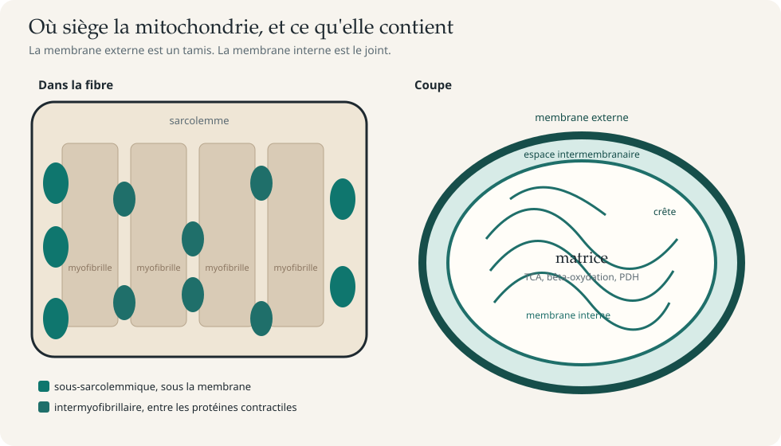
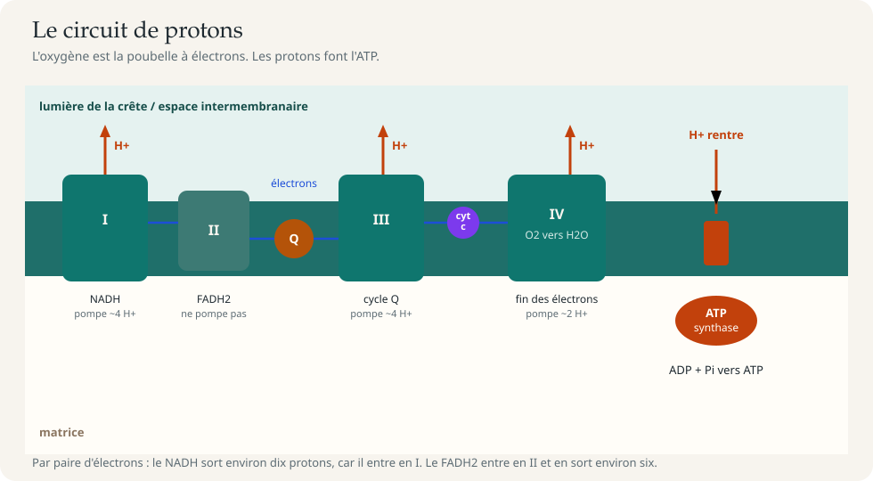
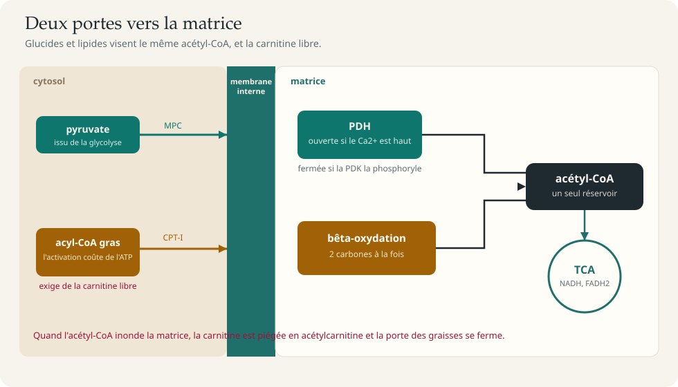
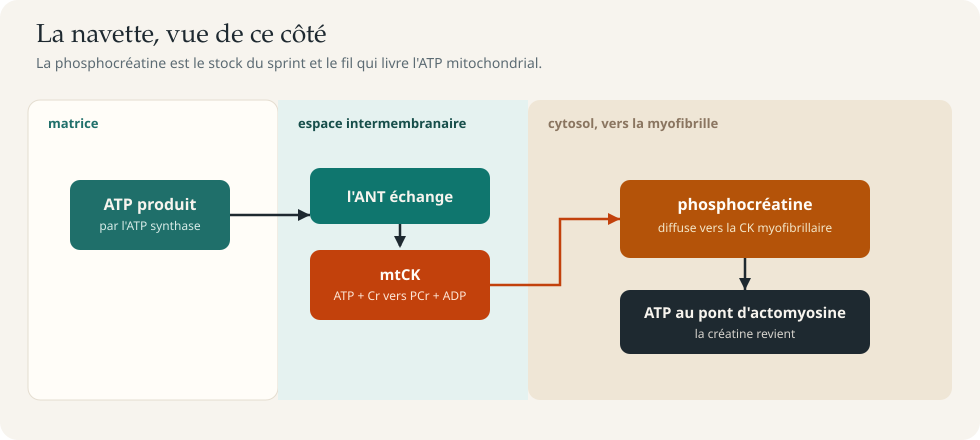

# Dans la mitochondrie

Notes de cours. 14 novembre 2026. Fait suite à [Comment un cycliste produit l'énergie](01-energy-systems.md).

Le cours précédent traitait la phosphorylation oxydative comme une seule boîte : grande capacité, puissance plus basse, lente à atteindre son plein débit, et de plus en plus en charge dès qu'un effort dure plus d'environ une minute. Ce cours ouvre la boîte. Les questions sont locales. Pourquoi cette voie a-t-elle besoin d'oxygène si le carburant est glucidique ou lipidique ? Pourquoi un effort dur ferme-t-il la porte des lipides même quand les lipides sont disponibles dans le sang ? Pourquoi le rendement en ATP par oxygène diffère-t-il pour les deux carburants ? Et qu'est-ce qui, physiquement, change dans le muscle quand l'entraînement d'endurance élève le plafond ?

Les figures sont des schémas dessinés pour ces notes. Elles gardent la topologie et laissent tomber la plupart des noms de protéines.

---

## 1. Où cela se place dans l'histoire de l'énergie

Trois voies refont l'ATP. Deux d'entre elles, la phosphocréatine et la glycolyse, le font dans le cytosol et n'utilisent pas d'oxygène. La troisième le fait dans les mitochondries, et c'est elle qui recharge les deux autres une fois l'effort installé.

Les liens avec le premier cours sont précis.

- Le pyruvate, la fin de la glycolyse, est un substrat mitochondrial. Le lactate est ce qui arrive au pyruvate qui ne passe pas la porte assez vite, et le lactate peut revenir plus tard comme carburant.
- La phosphocréatine n'est pas seulement le stock du sprint de dix secondes. En régime stable, c'est la molécule qui porte le phosphate de la mitochondrie au pont d'actomyosine.
- Le déficit d'oxygène de la première ou des deux premières minutes est le temps pendant lequel l'apport mitochondrial rattrape encore la demande. La phosphocréatine et la glycolyse couvrent le trou.
- Le basculement qui quitte les lipides au-dessus d'environ 60 à 65 % de VO2max est un choix fait à la membrane interne, pas une décision de « passer en anaérobie ».

Presque chaque ATP d'une côte, d'un contre-la-montre ou d'une étape est passé par la machine décrite plus bas.

---

## 2. Pas un haricot : un réticulum garé à côté du travail

Les manuels dessinent les mitochondries comme des capsules séparées. Dans le muscle squelettique, elles sont souvent connectées en un réticulum, un réseau ramifié plutôt qu'un sac d'organites indépendants. L'imagerie a soutenu que la force proton-motrice peut se propager le long de ce réseau, de sorte qu'une région de membrane près d'un capillaire peut soutenir une région de membrane à côté d'une myofibrille. L'image se précise encore. La partie utile est déjà solide : l'emplacement compte, et les organites sont disposés autour du travail qu'ils doivent alimenter.

Deux voisinages apparaissent sur les micrographies électroniques.

- Les mitochondries **intermyofibrillaires** siègent entre les myofibrilles, près des ponts et des pompes à calcium qui dépensent l'ATP.
- Les mitochondries **sous-sarcolemmiques** siègent en une couche sous la membrane cellulaire, près des capillaires, des noyaux, et des transporteurs qui font entrer le glucose et les acides gras.



<p class="figure-caption">Les mitochondries sous-sarcolemmiques longent la membrane, à côté du sang. Les mitochondries intermyofibrillaires sont contre les protéines contractiles. La coupe est une mitochondrie, agrandie.</p>

Les fibres de type I tiennent plus de volume mitochondrial et un réseau plus connecté. Les fibres de type II en tiennent moins. Elles ne sont pas, pour autant, sans mitochondries, et celles qu'elles ont ne sont pas une copie plus lente de l'organite de type I. Dans des fibres humaines triées après biopsie, la respiration maximale par fibre était environ 25 % plus haute dans les fibres lentes, comme on l'attend de leur plus grand contenu mitochondrial. Par unité de protéine mitochondriale, les mitochondries rapides respiraient environ 50 % plus vite quand les substrats des complexes I et II étaient tous deux présents, et ce débit en plus venait surtout du complexe II. Les mêmes mitochondries rapides portaient plus d'ATP synthase et plus des protéines qui forment les crêtes. L'échantillon était petit, sept personnes, donc il faut prendre les pourcentages comme une direction nette plutôt que comme une constante de population. La direction colle au vélo. Un sprint recrute des fibres de type II dont les mitochondries sont bâties pour aller fort pendant un temps court. Un effort d'endurance vit dans la population de type I, plus grande et plus stable.

Un muscle non entraîné peut consacrer quelques pourcents du volume de la fibre aux mitochondries. Un muscle entraîné en endurance en consacre nettement plus. Dans une comparaison de biopsies du vaste latéral, des coureurs et des skieurs de fond avaient environ 40 à 50 % de volume mitochondrial de plus que des personnes non entraînées, et l'écart était le plus grand dans la couche sous-sarcolemmique. Le volume n'est pas la seule chose qui bouge. Les plis à l'intérieur de chaque mitochondrie se densifient aussi. C'est la section suivante.

---

## 3. Quatre compartiments, et un seul d'entre eux est un joint

Une mitochondrie, ce sont deux membranes et deux espaces d'eau.

Membrane externe
: Perméable aux petits métabolites par des canaux anioniques dépendants du voltage (VDAC, aussi appelés porines). L'ATP, le phosphate, le pyruvate et la créatine la traversent facilement. Ce n'est pas la barrière qui permet à l'organite de tenir un gradient de protons.

Espace intermembranaire
: L'eau entre les deux membranes, en principe continue avec l'intérieur de chaque crête. Les protons pompés par la chaîne respiratoire s'accumulent ici. La créatine kinase mitochondriale siège ici, ce qui explique que ce mince espace compte pour le cyclisme et pas seulement pour la biochimie.

Membrane interne
: Le joint. Elle est riche en cardiolipine, un phospholipide, et elle est pliée en crêtes pour qu'un petit organite puisse tenir une grande surface de membrane. La chaîne respiratoire et l'ATP synthase vivent dans cette membrane. Le NADH, l'acétyl-CoA et les protons ne la traversent que par des transporteurs précis. Tout ce qui est sélectif dans l'usage des carburants et dans l'export de l'ATP se passe ici.

Matrice
: L'espace d'eau intérieur. La pyruvate déshydrogénase, le cycle des acides tricarboxyliques (TCA) et la bêta-oxydation vivent ici, avec le petit génome mitochondrial. Ce génome ne code que treize protéines, toutes des pièces de la chaîne respiratoire ou de l'ATP synthase. Le reste du protéome mitochondrial est codé dans le noyau et importé. L'entraînement change la production des deux génomes. Il ne change pas la chimie.

### Les crêtes sont la surface de puissance

Les machines qui font l'ATP siègent sur la membrane interne. Plus de membrane interne par litre de muscle veut dire une plus haute puissance oxydative, jusqu'au point où l'apport d'oxygène ou de carburant prend le relais.

Longtemps, la densité des crêtes, la surface de membrane interne par unité de volume mitochondrial, a été traitée comme à peu près constante, près de 30 µm² de membrane par µm³ de mitochondrie. Elle n'est pas constante dans le muscle humain. Les athlètes entraînés en endurance ont environ 23 % de surface de crêtes en plus par volume mitochondrial dans le vaste latéral que les personnes actives de loisir ou sédentaires, et cette densité suit VO2max du corps entier de plus près que le volume mitochondrial. Une comparaison ultérieure a retrouvé le même schéma autrement. Les groupes actifs avaient une densité de crêtes environ 20 à 25 % plus haute que le muscle non entraîné. Combinée à leur plus grand volume mitochondrial, la surface de crêtes *par litre de muscle* était environ 60 à 75 % plus haute. La respiration par unité de cette surface de crêtes était semblable quel que soit le statut d'entraînement et, dans ce jeu de données, quel que soit le sexe. L'entraînement n'a pas inventé une enzyme respiratoire plus efficace. Il a construit plus de la membrane sur laquelle les enzymes siègent.

C'est une solution attirante à un problème d'encombrement. Une fibre doit aussi tenir des myofibrilles, du glycogène et les membranes qui gèrent le calcium. Élever la densité des crêtes élève la puissance oxydative sans remettre toute la cellule à la matrice mitochondriale.

Les plis ne sont pas des rides passives. Les dimères d'ATP synthase courbent la membrane interne et fixent le bord de chaque crête. Les protons pompés dans une lumière de crête étroite y sont en partie confinés, de sorte que la force motrice à la synthase peut être plus haute que la moyenne de tout l'espace intermembranaire. Des protéines comme OPA1 et le complexe MICOS règlent l'étroitesse de la jonction de la crête. Les mitochondries rapides, qui ont moins de volume pour travailler, semblent investir dans cette machinerie de pliage. L'histoire structurale et l'histoire de respirométrie pointent dans le même sens : la membrane interne est l'actif.

---

## 4. Le circuit de protons

Le carburant n'est pas brûlé comme un feu brûle. Des enzymes arrachent des électrons aux glucides et aux lipides et les chargent sur deux transporteurs.

- Le **NADH**, qui donne des électrons au complexe I.
- Le **FADH2**, qui donne des électrons au complexe II. Dans la membrane, le complexe II passe ces électrons à l'ubiquinone. Le complexe II est aussi l'enzyme du TCA succinate déshydrogénase, donc le cycle et la chaîne sont la même protéine à cet endroit.

Les électrons coulent ensuite le long de la membrane interne : ubiquinone, complexe III, cytochrome c, complexe IV. Au complexe IV ils sont donnés à l'oxygène moléculaire, et l'oxygène est réduit en eau. C'est la seule raison pour laquelle la voie aérobie a besoin d'O2. L'oxygène est la poubelle à électrons. Ce n'est pas le carburant, et il n'est pas « brûlé » comme substrat du cycle TCA. Si l'oxygène manque, le complexe IV s'arrête, les transporteurs s'accumulent sous forme réduite, le NADH ne peut plus être réoxydé, et le cycle TCA s'arrête derrière eux. La voie glycolytique, qui n'a pas besoin que ces transporteurs soient réoxydés par les mitochondries, continue et fait du lactate.

Pendant que les électrons avancent, les complexes I, III et IV pompent des protons hors de la matrice. Un compte utile par paire d'électrons est :

| Entrée | Route | Protons sortis |
| --- | --- | --- |
| NADH | I → III → IV | environ 10 (à peu près 4 + 4 + 2) |
| FADH2 | II → III → IV, en sautant I | environ 6 (à peu près 0 + 4 + 2) |



<p class="figure-caption">Les électrons du NADH et du FADH2 vont jusqu'à l'oxygène. Seuls les complexes I, III et IV sortent des protons. L'ATP synthase laisse les protons rentrer et phosphoryle l'ADP. Le FADH2 saute le complexe I, donc il déplace moins de protons par oxygène utilisé au complexe IV.</p>

Le gradient de protons, électrique et chimique ensemble, est la force proton-motrice. Les protons rentrent dans la matrice par l'ATP synthase. Le flux tourne un rotor. Le rotor entraîne la formation d'ATP à partir d'ADP et de phosphate. L'ATP synthase des mammifères a un anneau d'environ huit sous-unités c, donc un tour complet prend environ huit protons et produit trois ATP. C'est déjà environ 2,7 protons par ATP au niveau de l'enzyme elle-même. Faire entrer l'ATP dans le cytosol coûte plus. La translocase des nucléotides d'adénine échange l'ATP de la matrice contre l'ADP cytosolique, et le transporteur de phosphate fait entrer le phosphate avec un proton. L'ATP que la myofibrille peut vraiment utiliser coûte donc plus près de quatre protons.

Diviser les protons pompés par ce coût fait apparaître les non-entiers familiers.

- Environ **2,5 ATP par NADH mitochondrial**.
- Environ **1,5 ATP par FADH2**.

Les vieux tableaux qui impriment 3 et 2 supposent un autre nombre de protons par tour et ignorent le coût de l'export. Ces entiers sont la raison pour laquelle certains manuels disent encore 36 ou 38 ATP par glucose. Les estimations de travail de ces notes restent à environ 2,5 et 1,5, ce qui explique que le cours précédent ait refusé un seul entier pour « ATP par glucose » et ait écrit une plage près de 30 plutôt que 36. Le NADH cytosolique de la glycolyse ajoute une autre ambiguïté : la navette malate-aspartate fait entrer ces électrons comme NADH, et la navette glycérol-3-phosphate les fait entrer comme FADH2. Le muscle oxydatif s'appuie sur la première. Le rendement exact dépend du mélange de navettes. L'ordre de grandeur, non.

Deux conséquences valent d'être gardées, parce qu'elles apparaissent sur le vélo.

D'abord, l'oxydation des glucides fait entrer une plus grande fraction de ses électrons sous forme de NADH que l'oxydation des lipides. La bêta-oxydation des lipides produit du NADH et du FADH2 en quantités égales sur le chemin de l'acétyl-CoA, puis l'acétyl-CoA passe par le même cycle TCA. Une plus grande part du flux d'électrons des lipides saute le complexe I. Même oxygène au complexe IV, moins de protons pompés, moins d'ATP par litre d'oxygène. C'est la raison, au niveau de la membrane, pour laquelle un litre d'oxygène rend environ 21,1 kJ à partir des glucides et environ 19,6 kJ à partir des lipides.

Ensuite, la puissance de la chaîne n'est haute par rapport à la glycolyse que lorsque beaucoup de copies sont présentes et que l'oxygène et l'ADP sont tous deux disponibles. Une seule voie de dix étapes enzymatiques dans le cytosol peut être allumée par des métabolites en une seconde. La route mitochondriale doit accélérer les déshydrogénases, livrer l'oxygène, et laisser l'ADP monter. C'est pourquoi son *débit* est plus lent à se développer même si son *rendement* est d'un ordre de grandeur plus grand.

---

## 5. Deux portes vers la matrice

L'acétyl-CoA est la monnaie commune. Les glucides et les lipides doivent tous deux devenir de l'acétyl-CoA dans la matrice, et ils utilisent des portes différentes. Les portes sont régulées séparément. Cette régulation est la version microscopique du basculement des carburants du premier cours.



<p class="figure-caption">Le pyruvate traverse sur le transporteur mitochondrial du pyruvate et est décarboxylé par la pyruvate déshydrogénase. Le lipide à longue chaîne traverse comme acyl-carnitine. Les deux portes produisent de l'acétyl-CoA pour le cycle TCA. Une forte charge d'acétyl-CoA piège la carnitine et rétrécit la porte des lipides.</p>

### La porte des glucides

Le pyruvate de la glycolyse traverse la membrane interne sur le transporteur mitochondrial du pyruvate. Dans la matrice, le complexe de la pyruvate déshydrogénase fait l'étape irréversible :

```text
pyruvate + CoA + NAD+  →  acétyl-CoA + CO2 + NADH
```

C'est l'étape engagée de l'oxydation des glucides. Le complexe est éteint quand les kinases de la pyruvate déshydrogénase le phosphorylent, et allumé quand la phosphatase enlève le phosphate. La contraction aide à l'allumer : le calcium libéré pour le pont active aussi la phosphatase. Une montée du pyruvate, du NAD+ et du CoA pousse la réaction en avant. Une montée de l'acétyl-CoA, du NADH et de l'ATP la repousse.

La fraction active de la pyruvate déshydrogénase augmente avec l'intensité de l'exercice. À une forte puissance aérobie, la plus grande part du complexe est sous forme active et le carbone glucidique se déverse dans le cycle TCA. Un glycogène bas, le jeûne et un régime riche en lipides élèvent les kinases, surtout PDK4, de sorte qu'une plus grande part du complexe siège sous forme inactive. La porte des glucides est alors en partie fermée à la même puissance où elle était ouverte. C'est une raison mitochondriale pour laquelle un coureur pauvre en glucides peut encore faire un moulinage facile et ne peut toujours pas tenir une forte fraction de VO2max. Les lipides peuvent fournir de l'acétyl-CoA, mais pas au débit qu'une course demande, et avec la porte des glucides retenue la cellule ne peut pas compenser.

Il y a une seconde raison, plus discrète, pour laquelle les glucides sont difficiles à remplacer. Le cycle TCA a besoin de ses intermédiaires, surtout l'oxaloacétate, sinon l'acétyl-CoA n'a rien avec quoi se condenser. Le pyruvate est une source anaplérotique de ces intermédiaires. Quand les glucides sont très bas, le cycle peut être limité par la taille du pool d'intermédiaires et pas seulement par l'apport d'acétyl-CoA. « Il suffit de brûler du gras » échoue deux fois : la porte est plus lente, et le hall qu'elle ouvre est en partie vide.

### La porte des lipides

Les acides gras à longue chaîne sont activés dans le cytosol en acyl-CoA. Cette activation coupe l'ATP en AMP, donc elle coûte deux équivalents d'ATP avant que l'énergie ne revienne. La membrane interne ne laisse pas passer l'acyl-CoA.

La navette de la carnitine est le contournement.

1. La carnitine palmitoyltransférase I, sur la membrane externe, échange le CoA contre de la carnitine.
2. L'acyl-carnitine traverse la membrane interne.
3. La carnitine palmitoyltransférase II, sur la face interne, rééchange la carnitine contre du CoA.
4. La bêta-oxydation raccourcit la chaîne de deux carbones à la fois. Chaque tour rend un NADH, un FADH2 et un acétyl-CoA.

La CPT-I est l'étape dont les manuels disent souvent qu'elle est bloquée par le malonyl-CoA. Ce contrôle est réel dans le muscle de rongeur au repos. Chez l'humain pendant l'exercice, le malonyl-CoA ne baisse pas et ne monte pas d'une façon qui explique tout le basculement. La limite aiguë plus claire est la carnitine libre.

Quand la glycolyse inonde la matrice d'acétyl-CoA, les groupes acétyle sont garés sur la carnitine, ce qui fait de l'acétylcarnitine. La carnitine libre baisse. La CPT-I a besoin de carnitine libre comme substrat. L'entrée des lipides ralentit même si le sang est plein d'acides gras. C'est pourquoi perfuser des lipides, ce qui restaure les acides gras plasmatiques, ne restaure pas l'oxydation des lipides à haute intensité. Le goulet s'est déplacé dans la fibre, vers un transporteur que l'oxydation des glucides a emprunté.

Les chiffres s'alignent avec le premier cours. L'oxydation absolue des lipides culmine près de 60 à 65 % de VO2max. Au-dessus, l'acétyl-CoA issu du pyruvate monte, la carnitine libre baisse, et les glucides prennent le relais. Aux puissances faciles, la charge d'acétyl-CoA est plus petite, la carnitine libre est disponible, et la bêta-oxydation porte une large part. Sur une longue sortie stable, l'usage du glycogène musculaire ralentit, les acides gras plasmatiques montent, et la porte des lipides se rouvre parce que la pression d'acétyle venue des glucides s'est relâchée.

### Le hall commun

Chaque acétyl-CoA qui entre dans le cycle TCA produit, par tour, deux CO2, trois NADH, un FADH2 et un GTP. Le GTP est un équivalent d'ATP au niveau du substrat, dans la matrice. Presque tout l'ATP, pourtant, vient après, quand le NADH et le FADH2 entraînent le circuit de protons.

Le calcium active l'isocitrate déshydrogénase et l'oxoglutarate déshydrogénase aussi bien que la pyruvate déshydrogénase. Le même ion qui démarre le pont accélère les trois déshydrogénases qui nourrissent la chaîne. La mitochondrie n'attend pas un ordre métabolique séparé. Elle écoute la contraction.

---

## 6. Amener l'ATP jusqu'à la myosine

L'ATP fait dans la matrice est au mauvais endroit. Les ponts sont à un micromètre ou plus, et l'ATP lui-même est un messager maladroit : sa concentration change à peine, et il diffuse plus lentement que la créatine.

L'autre moitié de la navette de la créatine du premier cours siège dans l'espace intermembranaire. La créatine kinase mitochondriale est logée entre les membranes interne et externe, à côté de la translocase des nucléotides d'adénine et de VDAC.

1. L'ATP synthase fait l'ATP dans la matrice.
2. La translocase l'exporte en échange d'ADP.
3. La créatine kinase mitochondriale transfère le phosphate à la créatine.
4. La phosphocréatine diffuse à travers VDAC jusqu'à la myofibrille, où l'autre créatine kinase refait l'ATP à côté de la myosine.
5. La créatine diffuse en retour. Son retour, et l'ADP laissé derrière, disent à la chaîne de continuer.



<p class="figure-caption">La créatine kinase mitochondriale siège entre les membranes. C'est la phosphocréatine, pas l'ATP, qui voyage jusqu'au pont. La créatine revient et tire l'ATP suivant hors de la matrice.</p>

Pendant une côte stable, c'est un système de livraison. Pendant un sprint, c'est aussi un réservoir, parce que le même pool de phosphocréatine peut donner son phosphate directement à l'ADP sans attendre la chaîne. Vider le réservoir pour un coup de cul vide donc le fil. Le reconstruire demande de l'ATP mitochondrial et de l'oxygène, ce qui explique que la récupération entre les relances soit un problème aérobie même si la relance elle-même a l'air anaérobie. L'acidose et une forte part de fibres de type II ralentissent cette reconstruction. Rester au-dessus de la puissance critique entre les efforts fait la même chose, parce que les mitochondries sont déjà occupées à tenir la puissance du moment et ont moins d'ATP de réserve pour la navette.

---

## 7. Pourquoi la consommation d'oxygène monte lentement

La chaîne respiratoire est rapide une fois que le NADH, l'ADP, le phosphate et l'oxygène sont tous présents. Le retard d'une à deux minutes de la consommation d'oxygène à la bouche n'est pas une enzyme lente. Ce sont plusieurs contrôles qui arrivent à des moments différents.

La phosphocréatine tamponne l'ATP au départ, donc l'ADP libre ne monte qu'à mesure que la phosphocréatine baisse. Les mitochondries sont tirées par l'ADP, à travers la navette qui vient d'être décrite. Elles suivent le tampon. Elles ne sautent pas devant. Inhiber la créatine kinase dans des modèles expérimentaux accélère en fait la montée de la consommation d'oxygène, ce qui est la preuve la plus nette que le tampon cache la réponse mitochondriale plutôt que les mitochondries ne soient intrinsèquement lentes.

La pyruvate déshydrogénase n'est pas pleinement active dans les premières secondes. L'apport d'acétyl-CoA retarde sur la demande de puissance. Un effort d'amorçage lourd laisse le complexe plus actif et accélère la cinétique de l'oxygène sur l'effort suivant. C'est la pièce mitochondriale de l'effet de l'échauffement. Elle est surtout utile pour les efforts de quelques minutes jusqu'à environ 40 minutes, la même fenêtre où le premier cours disait qu'une mise en route dure aide, et c'est une mauvaise idée avant une longue sortie qui commence facile, parce que l'amorce dépense du glycogène et ajoute de la fatigue sans bénéfice cinétique.

L'apport d'oxygène retarde aussi. Le débit sanguin et l'extraction locale n'atteignent pas la fibre instantanément. Chez les cyclistes entraînés, le plafond de VO2max est en grande partie fixé par l'apport d'oxygène, le débit cardiaque et le contenu artériel en oxygène, plutôt que par un manque d'enzymes mitochondriales. La *vitesse* de la montée, et le mélange de carburants à une puissance sous-maximale, sont beaucoup plus mitochondriaux. Les deux affirmations peuvent être vraies. Une plus grande mitochondrie n'élève pas VO2max sans un plus grand apport d'oxygène, et un plus grand apport d'oxygène ne choisit pas les lipides plutôt que les glucides au seuil.

Il ne faut pas réduire le retard à une phrase sur des mitochondries lentes. Le tampon, la déshydrogénase et le sang doivent chacun être d'accord avant que la consommation d'oxygène à la bouche égale la demande d'ATP dans la jambe.

---

## 8. Fuite, chaleur, et les 20 à 25 % du capteur de puissance

Tous les protons ne rentrent pas par l'ATP synthase. Certains refluent à travers la membrane interne. La fuite est de la chaleur. Elle empêche aussi le potentiel de membrane de rester si haut que la chaîne cale et lâche des électrons sur l'oxygène sous forme de superoxyde.

Le muscle squelettique exprime la protéine découplante 3. La part de la fuite ordinaire qu'elle porte pendant une sortie est encore discutée, et ces notes n'ont pas besoin d'un verdict. L'échange est le point. Une membrane plus étanche fait plus d'ATP par oxygène et peut faire plus d'espèces réactives de l'oxygène quand l'ADP manque. Une membrane plus fuyante gaspille de l'énergie en chaleur et peut baisser cette fuite d'électrons. Des athlètes d'endurance très entraînés, dans certaines comparaisons, montrent une fuite de protons plus basse par mitochondrie que des personnes entraînées de loisir, ce qui voudrait dire un couplage un peu plus étanche. C'est un petit terme à côté de tout le reste entre le glucose et la pédale.

Le rendement brut du cyclisme, environ 20 à 25 %, n'est pas le rapport P/O mitochondrial. C'est tout le chemin. Du carburant au gradient de protons, de l'énergie est déjà perdue en chaleur. Du gradient de protons à l'ATP, on en perd encore, y compris la fuite. De l'ATP au travail du pont, on est bien en dessous de la moitié. Les pompes ioniques prennent 20 à 40 % de l'ATP. Les jambes doivent aussi se déplacer elles-mêmes, ainsi que le vélo à vide. Le couplage mitochondrial est un facteur de ce produit. L'améliorer un peu ne fait pas passer le rendement de 20 % à 30 %.

---

## 9. Espèces réactives de l'oxygène, sans le conte moral

Les complexes I et III peuvent passer une fraction de leurs électrons à l'oxygène trop tôt, ce qui fait du superoxyde. Cela est favorisé quand la force proton-motrice est haute et que la chaîne est engorgée : au repos, ou dans les secondes après l'arrêt d'un effort dur, ou chaque fois que l'ADP est bas et que les protons n'ont nulle part d'utile où aller.

Dans un muscle au travail, l'ADP est disponible, les protons coulent par l'ATP synthase, la chaîne reste relativement oxydée, et le superoxyde par électron est souvent plus bas que le mot « stress oxydant » ne le suggère. Les ROS sont aussi des signaux. Elles participent à la réponse adaptative à l'entraînement. Ces notes les traitent comme une réaction secondaire d'une chaîne qui est censée être occupée, pas comme un dommage par défaut. Une chaîne qui n'a nulle part où mettre ses électrons est la situation à surveiller, et cette situation est le repos et la récupération plus que le milieu d'un effort au seuil.

---

## 10. Ce que l'entraînement change, à cette échelle

L'entraînement d'endurance ne substitue pas une nouvelle chaîne respiratoire. Il construit plus de la même chaîne, la tasse sur plus de membrane interne, et ouvre les portes des carburants à un stress relatif plus bas.

Les changements structuraux, d'après les études de biopsie ci-dessus :

- Plus de volume mitochondrial, surtout sous le sarcolemme, de l'ordre de 40 à 50 % dans les groupes entraînés par rapport aux non-entraînés.
- Des crêtes plus denses, environ 20 à 25 %, donc chaque mitochondrie tient plus de membrane interne.
- Le produit des deux, la surface de crêtes par litre de muscle, environ 60 à 75 % plus haute. La respiration par unité de cette surface a l'air semblable. Le gain est la quantité de membrane.

Les changements fonctionnels qui suivent :

- Plus de protéines de porte et de leur capacité : transporteurs d'acides gras, une plus haute capacité de la navette de la carnitine, plus de GLUT4 pour que le cytosol puisse nourrir le transporteur du pyruvate, et une plus grande fraction active de la pyruvate déshydrogénase à une puissance modérée.
- Une cinétique de l'oxygène plus rapide, à cause de la déshydrogénase et d'un débit sanguin plus rapide.
- À la *même puissance absolue*, plus d'oxydation des lipides et moins d'usage de glycogène, parce que la mitochondrie plus grande peut oxyder les lipides sans l'ADP haut et le fort flux glycolytique qui ferment la porte des lipides.
- À la *même intensité relative* près d'une course, les glucides dominent encore. La puissance maintenant demandée à chaque fibre est assez haute pour acétyler la carnitine et pour préférer le carburant qui rend plus d'ATP par oxygène. L'entraînement élève le plafond. Il n'abroge pas le basculement.

Le signal, en un paragraphe, suffit pour ce cours. La contraction répétée élève l'AMP, ce qui active l'AMPK, et élève le calcium, ce qui active des kinases dépendantes du calcium. Le stress mécanique et métabolique ajoute p38 MAPK et des voies voisines. Tout cela converge vers PGC-1α, un coactivateur des gènes nucléaires des protéines respiratoires, et vers la réplication de l'ADN mitochondrial. OPA1, les mitofusines et DRP1 remodèlent le réticulum et les crêtes. On n'a pas besoin de toute la carte pour utiliser le résultat. La fibre construit plus de membrane interne aux endroits où on lui demande sans cesse d'oxyder du carburant. Quelques séances dures par semaine fournissent un signal fort. Le volume facile fournit le temps et les pulses de calcium répétés. Ni l'un ni l'autre ne remplace l'autre, ce qui est une lecture mitochondriale de la raison pour laquelle l'entraînement polarisé a un gros volume à basse intensité et une petite dose à haute intensité.

---

## 11. Lire une sortie depuis l'intérieur de la matrice

| Situation | Ce que fait la mitochondrie |
| --- | --- |
| 10 premières secondes d'un sprint | La chaîne s'allume et ne couvre que quelques pourcents de l'ATP. La phosphocréatine baisse, donc le fil de livraison et le stock du sprint sont dépensés ensemble. La pyruvate déshydrogénase n'est pas encore à son pic actif. |
| Un sprint de 30 secondes | La chaîne est déjà environ un quart à un tiers de l'ATP. Le pyruvate est encore fabriqué plus vite que la porte ne peut le prendre, donc le lactate sort. Ce lactate est un tampon du retard, pas la preuve que les mitochondries sont éteintes. |
| Un kilo, environ 60 secondes, maximal | Dans la seconde moitié, la chaîne est le fournisseur majoritaire. Le déficit d'oxygène de la première moitié a déjà été payé en phosphocréatine et en lactate. |
| Une côte au seuil | La pyruvate déshydrogénase est surtout active. Le glycogène est la source principale de carbone. La carnitine libre est basse et la porte des lipides est étroite. Presque chaque ATP à la myosine est passé par l'ATP synthase puis par la navette de la créatine. |
| Endurance facile, des heures | La pyruvate déshydrogénase n'est qu'en partie active. La carnitine est libre. La bêta-oxydation est une large part, et les acides gras plasmatiques en prennent davantage à mesure que les heures passent et que l'usage du glycogène ralentit. |
| Effort dur avec glycogène bas | PDK est haute, la porte des glucides est retenue, et les intermédiaires du TCA sont plus difficiles à maintenir. Les lipides ne peuvent pas nourrir l'acétyl-CoA assez vite. La puissance baisse alors que les stocks adipeux sont encore pleins. |

Le tableau de durée du premier cours et ce tableau décrivent les mêmes événements à deux grossissements. À 75 secondes de travail maximal, la part aérobie passe 50 % parce que la chaîne a rattrapé, pas parce qu'un interrupteur a basculé. Au-dessus de la puissance critique, la chaîne est à son plafond, la consommation d'oxygène dérive vers VO2max, et l'ATP en plus vient encore de la phosphocréatine et de la glycolyse. Ce découvert est W′, vu depuis la matrice : la mitochondrie va déjà aussi vite que l'oxygène et les déshydrogénases le permettent, et le cytosol couvre le reste.

---

## 12. Quelques choses que cette image écarte

**Les mitochondries s'allument quand l'exercice devient aérobie.** Elles sont tirées par l'ADP et le calcium dès la première contraction. À dix secondes, elles sont une petite part d'une très grande demande d'ATP. Petit n'est pas la même chose qu'éteint.

**L'oxygène est le carburant.** Les carburants sont le pyruvate et les acides gras, et un peu d'acide aminé. L'oxygène accepte les électrons après que les protons ont été pompés. Sans oxygène, la poubelle est pleine, et les pompes s'arrêtent.

**Les lipides rendent plus d'énergie, donc ils devraient être le carburant de course.** Par gramme, oui. Par litre d'oxygène, non. L'allure de course est limitée par la vitesse à laquelle l'ATP peut être fait, et les glucides déplacent plus de protons par oxygène parce qu'une plus grande part de leurs électrons passe par le complexe I. Les lipides sont le carburant des heures faciles parce que le débit est assez bas pour que la porte de la carnitine reste ouverte, et parce que les stocks sont vastes.

**Plus de mitochondries veut dire automatiquement un VO2max plus haut.** Elles élèvent la capacité du membre à utiliser l'oxygène et elles changent l'usage des carburants et la cinétique. Chez un cycliste entraîné, le plafond systémique est encore surtout la livraison. Les deux adaptations doivent avancer ensemble.

**Le lactate veut dire que les mitochondries sont anaérobies.** Le lactate veut dire que le pyruvate a été produit plus vite que la pyruvate déshydrogénase et la navette du NADH ne l'ont pris. Cela arrive à fort flux glycolytique avec un oxygène normal, ce qui est l'état habituel d'une côte dure.

---

## 13. Des chiffres qui valent d'être retenus

- La membrane interne est le joint. La membrane externe est un tamis.
- Environ 10 protons par NADH et environ 6 par FADH2, puis environ 2,5 et 1,5 ATP une fois l'export compté.
- Les lipides donnent moins d'ATP par litre d'oxygène parce qu'une plus grande part de leurs électrons arrive comme FADH2 et saute le complexe I.
- La porte des lipides se rétrécit à haute intensité parce que la carnitine libre est piégée en acétylcarnitine, pas parce que le sang n'a plus d'acides gras.
- Le muscle entraîné a plus de volume mitochondrial et des crêtes plus denses. La surface de crêtes par litre de muscle est la quantité qui suit la puissance oxydative. La respiration par unité de cette surface a l'air semblable.
- Fibres de type I : plus de volume mitochondrial. Fibres de type II : moins de volume, respiration plus rapide par mitochondrie, davantage par le complexe II.
- La phosphocréatine est le fil de livraison en régime stable et le stock du sprint quand le fil est pillé. La recharger est mitochondrial.

---

## 14. Ce que ces notes laissent encore fermé

- Le chemin de l'oxygène depuis l'air jusqu'à la cytochrome oxydase, et pourquoi la livraison, plutôt que les crêtes, plafonne VO2max chez les coureurs entraînés.
- Comment une biopsie, un respiromètre et un spectromètre proche infrarouge voient chacun une tranche différente de cette histoire.
- Quelles séances élèvent vraiment la densité des crêtes et la pyruvate déshydrogénase, par opposition aux séances qui ne font que dépenser W′.
- Les particules de glycogène assises à côté des mitochondries, et pourquoi la dernière heure d'une longue sortie échoue localement même pendant que le foie libère encore un peu de glucose.

---

## Sources

- Glancy B et al. Mitochondrial reticulum for cellular energy distribution in muscle. *Nature*. 2015. L'image du réticulum connecté et l'idée que la force proton-motrice peut être partagée le long de celui-ci.
- Nielsen J et al. Plasticity in mitochondrial cristae density allows metabolic capacity modulation in human skeletal muscle. *Journal of Physiology*. 2017. [PMC5407961](https://pmc.ncbi.nlm.nih.gov/articles/PMC5407961/). Environ 23 % de densité de crêtes en plus dans le vaste latéral entraîné en endurance, et un lien plus étroit avec VO2max que le volume mitochondrial seul.
- Schytz CT et al. Skeletal muscle mitochondria demonstrate similar respiration per cristae surface area independent of training status and sex. *Journal of Physiology*. 2023. [doi:10.1113/JP285091](https://doi.org/10.1113/jp285091). Volume environ 40 à 50 % plus haut chez les coureurs et les skieurs que dans le muscle non entraîné, densité des crêtes environ 20 à 25 % plus haute dans les groupes actifs, surface de crêtes par volume musculaire environ 60 à 75 % plus haute, respiration par surface de crêtes semblable.
- Edman S, Flockhart M, Larsen FJ, Apró W. Need for speed: human fast-twitch mitochondria favor power over efficiency. *Molecular Metabolism*. 2024. [PMC10788296](https://pmc.ncbi.nlm.nih.gov/articles/PMC10788296/). Respirométrie par type de fibre : plus de respiration par fibre en type I, environ 50 % de respiration en plus par mitochondrie en type II, surtout via le complexe II. Petit échantillon.
- Watt IN, Montgomery MG, Runswick MJ, Leslie AGW, Walker JE. Bioenergetic cost of making an adenosine triphosphate molecule in animal mitochondria. *Nature*. 2010. L'anneau c à huit sous-unités qui rend faux l'entier de trois ATP par tour.
- Brand MD, Nicholls DG. Assessing mitochondrial dysfunction in cells. *Biochemical Journal*. 2011. Et Hinkle PC, 2005, sur les rapports P/O près de 2,5 et 1,5 une fois le transport compté. Les comptes de protons de ces notes sont l'arrondi pédagogique standard de cette littérature.
- Kühlbrandt W. Structure and function of mitochondrial membrane protein complexes. *BMC Biology*. 2015. Dimères d'ATP synthase et forme des crêtes. Strauss et al., *EMBO Journal* 2008, et Davies et al. sur la même architecture.
- Schlattner U, Tokarska-Schlattner M, Wallimann T. Mitochondrial creatine kinase in human health and disease. *Biochimica et Biophysica Acta*. 2006. L'arrangement ANT–mtCK–VDAC utilisé dans la section sur la navette.
- Howlett RA et al. Regulation of skeletal muscle pyruvate dehydrogenase at varying exercise power outputs. *American Journal of Physiology*. 1998. Et les revues de Spriet citées dans le premier cours. Activation de la pyruvate déshydrogénase selon l'intensité, et le rôle du calcium aux déshydrogénases.
- Constantin-Teodosiu D, Carlin JI, Cederblad G, Harris RC, Hultman E. Acetyl group accumulation and pyruvate dehydrogenase activity in human muscle during incremental exercise. *Acta Physiologica Scandinavica*. 1992. L'acétylcarnitine monte avec l'intensité.
- Stephens FB, Constantin-Teodosiu D, Greenhaff PL. New insights concerning the role of carnitine in the regulation of fuel metabolism in skeletal muscle. *Journal of Physiology*. 2007. La carnitine libre comme limite aiguë de la CPT-I quand l'acétyl-CoA est haut. L'histoire du malonyl-CoA est traitée comme le contrôle du rongeur au repos, pas comme le basculement de l'exercice humain.
- Wall BT et al. Chronic oral ingestion of L-carnitine and carbohydrate increases muscle carnitine content and alters muscle fuel metabolism during exercise. *Journal of Physiology*. 2011. Preuve que le pool de carnitine peut être assez grand pour compter, gardée ici comme mécanisme plutôt que comme recommandation de complément.
- Pilegaard H, Neufer PD. Transcriptional regulation of pyruvate dehydrogenase kinase 4 in skeletal muscle during and after exercise. *Proceedings of the Nutrition Society*. 2004. Et Burke LM et al., *Journal of Physiology* 2017, sur les régimes pauvres en glucides qui retiennent l'oxydation des glucides et dégradent l'économie à l'intensité de course.
- Bricker DK et al. A mitochondrial pyruvate carrier required for pyruvate uptake in yeast, Drosophila, and humans. *Science*. 2012. Le transporteur nommé dans la porte des glucides.
- Egan B, Zierath JR. Exercise metabolism and the molecular regulation of skeletal muscle adaptation. *Cell Metabolism*. 2013. Le court récit de l'AMPK, de la signalisation du calcium et de PGC-1α.
- Hargreaves M, Spriet LL. Skeletal muscle energy metabolism during exercise. *Nature Metabolism*. 2020. Le cadre qui garde ce cours attaché au premier.
