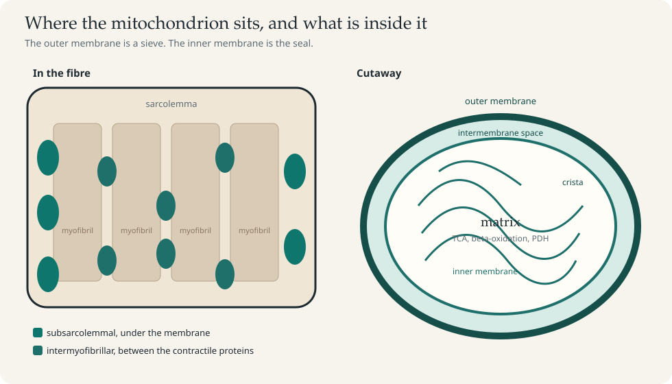
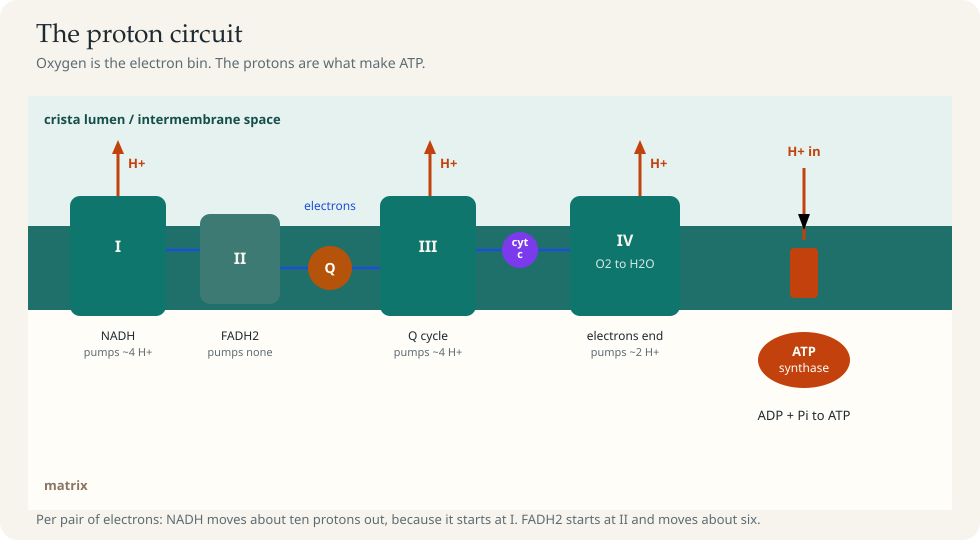
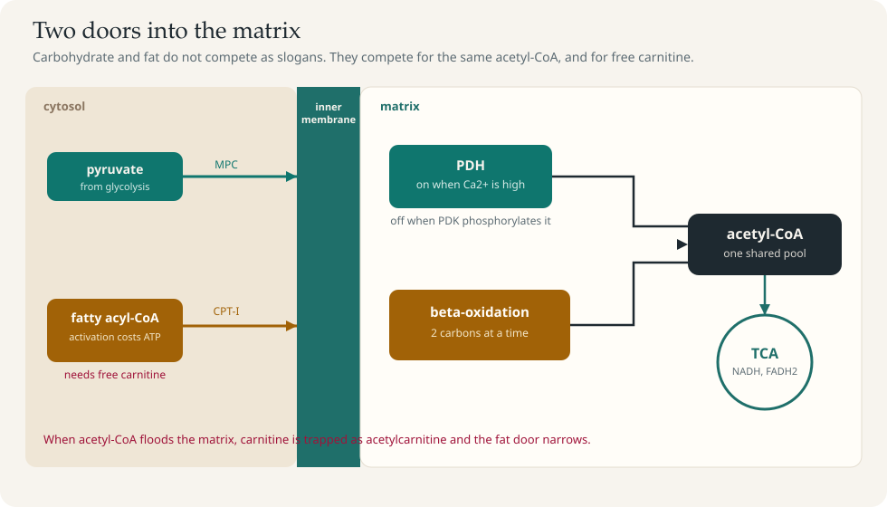
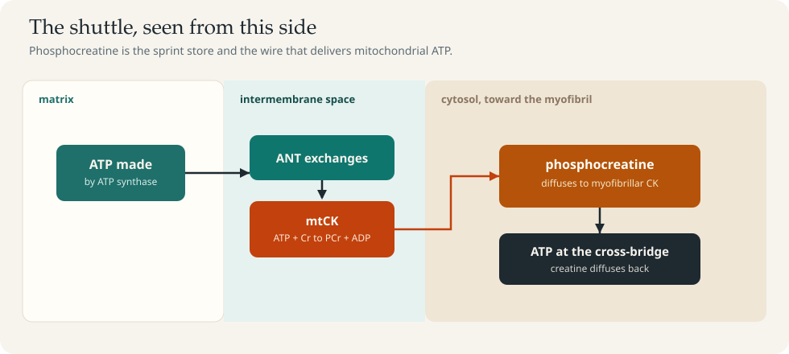

# Inside the mitochondrion

Lecture notes. 14 November 2026. Follows [How a cyclist makes energy](01-energy-systems.md).

The previous lecture treated oxidative phosphorylation as one box: high capacity, lower power, slow to reach full rate, and increasingly in charge once an effort lasts more than about a minute. This lecture opens the box. The questions are local. Why does that pathway need oxygen if the fuel is carbohydrate or fat? Why does a hard effort shut the door on fat even when fat is available in the blood? Why is the ATP yield per oxygen different for the two fuels? And what, physically, changes in the muscle when endurance training raises the ceiling?

The figures are schematics drawn for these notes. They keep the topology and drop most of the protein names.

---

## 1. Where this sits in the energy story

Three pathways remake ATP. Two of them, phosphocreatine and glycolysis, do it in the cytosol and do not use oxygen. The third does it in mitochondria, and it is the one that refills the other two once the effort settles.

The connections back to the first lecture are specific.

- Pyruvate, the end of glycolysis, is a mitochondrial substrate. Lactate is what happens to the pyruvate that does not get through the door fast enough, and lactate can come back later as a fuel.
- Phosphocreatine is not only the ten-second sprint store. During steady riding it is the molecule that carries phosphate from the mitochondrion to the cross-bridge.
- The oxygen deficit of the first one or two minutes is the time during which the mitochondrial supply is still catching the demand. Phosphocreatine and glycolysis cover the gap.
- The crossover away from fat above about 60–65% of VO2max is a choice made at the inner membrane, not a decision to "go anaerobic."

Almost every ATP in a climb, a time trial, or a road stage passed through the machine described below.

---

## 2. Not a bean: a reticulum parked next to the work

Textbooks draw mitochondria as separate capsules. In skeletal muscle they are often connected into a reticulum, a branching network rather than a bag of independent organelles. Imaging work has argued that the proton-motive force can spread along that network, so a region of membrane near a capillary can support a region of membrane next to a myofibril. The picture is still being refined. The useful part is already solid: location matters, and the organelles are arranged around the work they have to supply.

Two neighbourhoods show up on electron micrographs.

- **Intermyofibrillar** mitochondria sit between the myofibrils, close to the cross-bridges and the calcium pumps that spend ATP.
- **Subsarcolemmal** mitochondria sit in a layer under the cell membrane, close to the capillaries, the nuclei, and the transporters that bring in glucose and fatty acids.



<p class="figure-caption">Subsarcolemmal mitochondria line the membrane, next to the blood. Intermyofibrillar mitochondria sit against the contractile proteins. The cutaway is one mitochondrion, enlarged.</p>

Type I fibres hold more mitochondrial volume and a more connected network. Type II fibres hold less. They are not, however, mitochondria-free, and the ones they have are not a slower copy of the type I organelle. In human fibres sorted after biopsy, maximal respiration per fibre was about 25% higher in slow-twitch fibres, as expected from their larger mitochondrial content. Per unit of mitochondrial protein, the fast-twitch mitochondria respired about 50% faster when both complex I and complex II substrates were present, and that extra rate came mostly through complex II. The same fast-twitch mitochondria carried more ATP synthase and more of the proteins that shape cristae. The sample was small, seven people, so treat the percentages as a clear direction rather than a population constant. The direction fits the bike. A sprint recruits type II fibres whose mitochondria are built to go hard for a short time. An endurance effort lives in the larger, steadier type I population.

Untrained muscle might devote a few percent of fibre volume to mitochondria. Endurance-trained muscle devotes substantially more. In one comparison of vastus lateralis biopsies, runners and cross-country skiers had about 40–50% more mitochondrial volume than untrained people, and the gap was largest in the subsarcolemmal layer. Volume is not the only thing that moves. The folds inside each mitochondrion get denser too. That is the next section.

---

## 3. Four compartments, and only one of them is a seal

A mitochondrion is two membranes and two water spaces.

Outer membrane
: Permeable to small metabolites through voltage-dependent anion channels (VDAC, also called porins). ATP, phosphate, pyruvate, and creatine cross it easily. It is not the barrier that lets the organelle hold a proton gradient.

Intermembrane space
: The water between the two membranes, continuous in principle with the inside of each crista. Protons pumped by the respiratory chain accumulate here. Mitochondrial creatine kinase sits here, which is why this thin space matters for cycling and not only for biochemistry.

Inner membrane
: The seal. It is rich in the phospholipid cardiolipin and is folded into cristae so that a small organelle can hold a large area of membrane. The respiratory chain and ATP synthase live in this membrane. NADH, acetyl-CoA, and protons do not cross it except through specific carriers. Everything selective about fuel use and about ATP export happens here.

Matrix
: The inner water space. Pyruvate dehydrogenase, the tricarboxylic acid (TCA) cycle, and beta-oxidation live here, along with the small mitochondrial genome. That genome encodes only thirteen proteins, all of them pieces of the respiratory chain or ATP synthase. The rest of the mitochondrial proteome is encoded in the nucleus and imported. Training changes both genomes' output. It does not change the chemistry.

### Cristae are the power surface

The machines that make ATP sit on the inner membrane. More inner membrane per litre of muscle means a higher oxidative power, up to the point where oxygen delivery or fuel supply takes over.

For a long time cristae density, the inner-membrane area per unit of mitochondrial volume, was treated as roughly constant, near 30 µm² of membrane per µm³ of mitochondrion. It is not constant in human muscle. Endurance-trained athletes have about 23% more cristae surface per mitochondrial volume in vastus lateralis than recreationally active or sedentary people, and that density tracks whole-body VO2max more closely than mitochondrial volume does. A later comparison found the same pattern in a different way. Active groups had about 20–25% higher cristae density than untrained muscle. Combined with their larger mitochondrial volume, the cristae surface *per litre of muscle* was about 60–75% higher. Respiration per unit of that cristae surface was similar across training status and, in that dataset, across sex. Training did not invent a more efficient respiratory enzyme. It built more of the membrane the enzymes sit on.

That is an attractive solution to a packing problem. A fibre also has to hold myofibrils, glycogen, and the calcium-handling membranes. Raising cristae density raises oxidative power without handing the whole cell over to mitochondrial matrix.

The folds are not passive wrinkles. ATP synthase dimers bend the inner membrane and pin the rim of each crista. Protons pumped into a narrow crista lumen are partly confined there, so the driving force at the synthase can be higher than the average of the whole intermembrane space. Proteins such as OPA1 and the MICOS complex set how tight the crista junction is. Fast-twitch mitochondria, which have less volume to work with, seem to invest in this folding machinery. The structural story and the respirometry story point the same way: the inner membrane is the asset.

---

## 4. The proton circuit

Fuel is not burned in the way a fire burns. Enzymes strip electrons from carbohydrate and fat and load them onto two carriers.

- **NADH**, which donates electrons to complex I.
- **FADH2**, which donates electrons to complex II. In the membrane, complex II hands those electrons to ubiquinone. Complex II is also the TCA enzyme succinate dehydrogenase, so the cycle and the chain are the same protein at that point.

The electrons then flow along the inner membrane: ubiquinone, complex III, cytochrome c, complex IV. At complex IV they are given to molecular oxygen, and oxygen is reduced to water. That is the only reason the aerobic pathway needs O2. Oxygen is the electron bin. It is not the fuel, and it is not "burned" as a substrate of the TCA cycle. If oxygen runs out, complex IV stops, the carriers back up in their reduced form, NADH cannot be reoxidized, and the TCA cycle stops behind them. The glycolytic pathway, which does not need those carriers to be reoxidized by mitochondria, keeps going and makes lactate.

As the electrons move, complexes I, III, and IV pump protons out of the matrix. A working count per pair of electrons is:

| Entry | Route | Protons moved out |
| --- | --- | --- |
| NADH | I → III → IV | about 10 (roughly 4 + 4 + 2) |
| FADH2 | II → III → IV, skipping I | about 6 (roughly 0 + 4 + 2) |



<p class="figure-caption">Electrons from NADH and FADH2 run to oxygen. Only complexes I, III, and IV move protons out. ATP synthase lets protons back in and phosphorylates ADP. FADH2 skips complex I, so it moves fewer protons per oxygen used at complex IV.</p>

The proton gradient, electrical and chemical together, is the proton-motive force. Protons re-enter the matrix through ATP synthase. The flow turns a rotor. The rotor drives the formation of ATP from ADP and phosphate. Mammalian ATP synthase has a ring of about eight c-subunits, so a full turn takes about eight protons and produces three ATP. That is already about 2.7 protons per ATP at the enzyme itself. Getting the ATP into the cytosol costs more. The adenine nucleotide translocase swaps matrix ATP for cytosolic ADP, and the phosphate carrier brings phosphate in together with a proton. The ATP the myofibril can actually use therefore costs closer to four protons.

Divide the protons pumped by that cost and the familiar non-integers appear.

- About **2.5 ATP per mitochondrial NADH**.
- About **1.5 ATP per FADH2**.

Older tables that print 3 and 2 assume a different number of protons per turn and ignore the cost of export. Those integers are why some textbooks still say 36 or 38 ATP per glucose. The working estimates in these notes stay at about 2.5 and 1.5, which is why the previous lecture refused a single integer for "ATP per glucose" and wrote a range near 30 rather than 36. Cytosolic NADH from glycolysis adds another ambiguity: the malate–aspartate shuttle passes those electrons in as NADH, and the glycerol-3-phosphate shuttle passes them in as FADH2. Oxidative muscle leans on the first. The exact yield depends on the shuttle mix. The order of magnitude does not.

Two consequences are worth keeping, because they show up on the bike.

First, carbohydrate oxidation feeds a higher fraction of its electrons in as NADH than fat oxidation does. Fat's beta-oxidation produces NADH and FADH2 in equal amounts on the way to acetyl-CoA, and then the acetyl-CoA goes through the same TCA cycle. More of the electron flux from fat skips complex I. Same oxygen at complex IV, fewer protons pumped, less ATP per litre of oxygen. That is the membrane-level reason one litre of oxygen yields about 21.1 kJ from carbohydrate and about 19.6 kJ from fat.

Second, the chain's power is high compared with glycolysis only when many copies of it are present and oxygen and ADP are both available. A single pathway of ten enzyme steps in the cytosol can be switched on by metabolites in a second. The mitochondrial route has to accelerate dehydrogenases, deliver oxygen, and let ADP rise. That is why its *rate* is slower to develop even though its *yield* is an order of magnitude larger.

---

## 5. Two doors into the matrix

Acetyl-CoA is the shared currency. Carbohydrate and fat both have to become acetyl-CoA inside the matrix, and they use different doors. The doors are regulated separately. That regulation is the micro version of the fuel crossover in the first lecture.



<p class="figure-caption">Pyruvate crosses on the mitochondrial pyruvate carrier and is decarboxylated by pyruvate dehydrogenase. Long-chain fat crosses as acyl-carnitine. Both doors produce acetyl-CoA for the TCA cycle. A high acetyl-CoA load traps carnitine and narrows the fat door.</p>

### The carbohydrate door

Pyruvate from glycolysis crosses the inner membrane on the mitochondrial pyruvate carrier. In the matrix, the pyruvate dehydrogenase complex runs the irreversible step:

```text
pyruvate + CoA + NAD+  →  acetyl-CoA + CO2 + NADH
```

This is the committed step for carbohydrate oxidation. The complex is off when pyruvate dehydrogenase kinases phosphorylate it, and on when the phosphatase takes the phosphate off. Contraction helps turn it on: calcium released for the cross-bridge also activates the phosphatase. A rise in pyruvate, NAD+, and CoA pushes the reaction forward. A rise in acetyl-CoA, NADH, and ATP pushes it back.

The active fraction of pyruvate dehydrogenase increases with exercise intensity. At a hard aerobic power, most of the complex is in the active form and carbohydrate carbon is pouring into the TCA cycle. Low glycogen, fasting, and a high-fat diet raise the kinases, especially PDK4, so more of the complex sits in the inactive form. The carbohydrate door is then partly shut at the same power where it used to be open. That is a mitochondrial reason a low-carbohydrate rider can still do an easy spin and still cannot hold a high fraction of VO2max. Fat can supply acetyl-CoA, but not at the rate a race demands, and with the carbohydrate door restrained the cell cannot make up the difference.

There is a second, quieter reason carbohydrate is hard to replace. The TCA cycle needs its intermediates, especially oxaloacetate, or acetyl-CoA has nothing to condense with. Pyruvate is an anaplerotic source of those intermediates. When carbohydrate is very low, the cycle can be limited by the size of the intermediate pool and not only by the supply of acetyl-CoA. "Just burn fat" fails twice: the door is slower, and the hall it opens into is partly empty.

### The fat door

Long-chain fatty acids are activated in the cytosol to acyl-CoA. That activation splits ATP to AMP, so it costs two ATP-equivalents before any energy comes back. The inner membrane does not let acyl-CoA through.

The carnitine shuttle is the workaround.

1. Carnitine palmitoyltransferase I, on the outer membrane, swaps the CoA for carnitine.
2. Acyl-carnitine crosses the inner membrane.
3. Carnitine palmitoyltransferase II, on the inner face, swaps carnitine back for CoA.
4. Beta-oxidation shortens the chain by two carbons at a time. Each round yields one NADH, one FADH2, and one acetyl-CoA.

CPT-I is the step textbooks often say is blocked by malonyl-CoA. That control is real in resting rodent muscle. In humans during exercise, malonyl-CoA does not fall and rise in a way that explains the whole crossover. The clearer acute limit is free carnitine.

As glycolysis floods the matrix with acetyl-CoA, acetyl groups are parked on carnitine, making acetylcarnitine. Free carnitine falls. CPT-I needs free carnitine as a substrate. Fat entry slows even if the blood is full of fatty acids. This is why infusing fat, which restores plasma fatty acids, does not restore fat oxidation at high intensity. The bottleneck has moved inside the fibre, to a carrier that carbohydrate oxidation has borrowed.

The numbers line up with the first lecture. Absolute fat oxidation peaks near 60–65% of VO2max. Above that, acetyl-CoA from pyruvate rises, free carnitine falls, and carbohydrate takes over. At easy powers the acetyl-CoA load is smaller, free carnitine is available, and beta-oxidation carries a large share. Over a long steady ride, muscle glycogen use slows, plasma fatty acids rise, and the fat door opens wider again because the acetyl pressure from carbohydrate has eased.

### The shared hall

Each acetyl-CoA that enters the TCA cycle produces, per turn, two CO2, three NADH, one FADH2, and one GTP. The GTP is a substrate-level ATP equivalent inside the matrix. Nearly all of the ATP, though, comes afterwards, when the NADH and FADH2 drive the proton circuit.

Calcium activates isocitrate dehydrogenase and oxoglutarate dehydrogenase as well as pyruvate dehydrogenase. The same ion that starts the cross-bridge speeds the three dehydrogenases that feed the chain. The mitochondrion is not waiting for a separate metabolic command. It is listening to the contraction.

---

## 6. Getting the ATP to the myosin

ATP made in the matrix is in the wrong place. The cross-bridges are a micrometre or more away, and ATP itself is a clumsy messenger: its concentration barely changes, and it diffuses more slowly than creatine.

The other half of the creatine shuttle from the first lecture sits in the intermembrane space. Mitochondrial creatine kinase is lodged between the inner and outer membranes, next to the adenine nucleotide translocase and VDAC.

1. ATP synthase makes ATP in the matrix.
2. The translocase exports it in exchange for ADP.
3. Mitochondrial creatine kinase transfers the phosphate to creatine.
4. Phosphocreatine diffuses through VDAC to the myofibril, where the other creatine kinase rebuilds ATP next to myosin.
5. Creatine diffuses back. Its return, and the ADP left behind, tell the chain to keep going.



<p class="figure-caption">Mitochondrial creatine kinase sits between the membranes. Phosphocreatine, not ATP, is what travels to the cross-bridge. Creatine comes back and pulls the next ATP out of the matrix.</p>

During a steady climb this is a delivery system. During a sprint it is also a fuel tank, because the same phosphocreatine pool can donate its phosphate directly to ADP without waiting for the chain. Emptying the tank for a kick therefore empties the wire. Rebuilding it requires mitochondrial ATP and oxygen, which is why the recovery between jumps is an aerobic problem even though the jump itself looks anaerobic. Acidosis and a high type II share slow that rebuilding. Sitting above critical power between efforts does the same thing, because the mitochondria are already busy holding the current power and have less spare ATP for the shuttle.

---

## 7. Why oxygen uptake rises slowly

The respiratory chain is fast once NADH, ADP, phosphate, and oxygen are all present. The one-to-two-minute lag in oxygen uptake at the mouth is not a slow enzyme. It is several controls arriving at different times.

Phosphocreatine buffers ATP at the onset, so free ADP rises only as phosphocreatine falls. Mitochondria are pulled by ADP, through the shuttle just described. They follow the buffer. They do not jump ahead of it. Inhibiting creatine kinase in experimental models actually speeds the rise in oxygen uptake, which is the cleanest evidence that the buffer is hiding the mitochondrial response rather than the mitochondria being intrinsically sluggish.

Pyruvate dehydrogenase is not fully active in the first seconds. Acetyl-CoA supply lags the power demand. A priming bout of heavy exercise leaves the complex more active and speeds oxygen kinetics on the next bout. That is the mitochondrial piece of the warm-up effect. It is most useful for efforts of a few minutes up to about 40 minutes, the same window where the first lecture said a hard opener helps, and it is a poor idea before a long ride that starts easy, because the primer spends glycogen and adds fatigue for no kinetic benefit.

Oxygen delivery lags as well. Blood flow and local extraction do not reach the fibre instantly. In trained cyclists the ceiling of VO2max is largely set by oxygen delivery, cardiac output and arterial oxygen content, rather than by a shortage of mitochondrial enzymes. The *speed* of the rise, and the fuel mix at a submaximal power, are much more mitochondrial. Both statements can be true. A larger mitochondrion does not raise VO2max without a larger oxygen supply, and a larger oxygen supply does not choose fat over carbohydrate at threshold.

Do not collapse the lag into one sentence about slow mitochondria. The buffer, the dehydrogenase, and the blood each have to agree before oxygen uptake at the mouth matches the ATP demand in the leg.

---

## 8. Leak, heat, and the 20–25% on the power meter

Not every proton re-enters through ATP synthase. Some leak back across the inner membrane. Leak is heat. It also keeps the membrane potential from sitting so high that the chain stalls and drops electrons onto oxygen as superoxide.

Skeletal muscle expresses uncoupling protein 3. How much of ordinary leak it carries during a ride is still argued, and these notes do not need a verdict. The trade is the point. A tighter membrane makes more ATP per oxygen and can make more reactive oxygen species when ADP is scarce. A leakier membrane wastes energy as heat and can lower that electron leak. Very fit endurance athletes in some comparisons show lower proton leak per mitochondrion than recreationally trained people, which would mean a slightly tighter coupling. It is a small term next to everything else between glucose and the pedal.

Cycling gross efficiency, about 20–25%, is not the mitochondrial P/O ratio. It is the whole path. Fuel to proton gradient already loses energy as heat. Proton gradient to ATP loses more, including leak. ATP to cross-bridge work is well below half. Ion pumps take 20–40% of the ATP. The legs also have to move themselves and the unloaded bike. Mitochondrial coupling is one factor in that product. Improving it a little does not move efficiency from 20% to 30%.

---

## 9. Reactive oxygen species, without the morality tale

Complexes I and III can pass a fraction of their electrons to oxygen early, making superoxide. This is favoured when the proton-motive force is high and the chain is backed up: at rest, or in the seconds after a hard effort stops, or whenever ADP is low and protons have nowhere useful to go.

In a working muscle, ADP is available, protons flow through ATP synthase, the chain stays relatively oxidized, and superoxide per electron is often lower than the word "oxidative stress" suggests. ROS are also signals. They participate in the adaptive response to training. These notes treat them as a side reaction of a chain that is supposed to be busy, not as damage by default. A chain with nowhere to put its electrons is the situation to watch, and that situation is rest and recovery more than the middle of a threshold effort.

---

## 10. What training changes, at this scale

Endurance training does not swap in a new respiratory chain. It builds more of the same chain, packs it onto more inner membrane, and opens the fuel doors at a lower relative stress.

The structural changes, from the biopsy studies above:

- More mitochondrial volume, especially under the sarcolemma, on the order of 40–50% in trained versus untrained groups.
- Denser cristae, about 20–25%, so each mitochondrion holds more inner membrane.
- The product of those two, cristae area per litre of muscle, about 60–75% higher. Respiration per unit of that area looks similar. The gain is quantity of membrane.

The functional changes that follow:

- More of the door proteins and their capacity: fatty-acid transporters, a higher capacity of the carnitine shuttle, more GLUT4 so the cytosol can feed the pyruvate carrier, and a larger active fraction of pyruvate dehydrogenase at a moderate power.
- Faster oxygen kinetics, from the dehydrogenase and from faster blood flow.
- At the *same absolute power*, more fat oxidation and less glycogen use, because the larger mitochondrion can oxidize fat without the high ADP and the high glycolytic flux that close the fat door.
- At the *same relative intensity* near a race, carbohydrate still dominates. The power now asked of each fibre is high enough to acetylate carnitine and to prefer the fuel that yields more ATP per oxygen. Training raises the ceiling. It does not repeal the crossover.

The signal, in one paragraph, is enough for this lecture. Repeated contraction raises AMP, which activates AMPK, and raises calcium, which activates calcium-dependent kinases. Mechanical and metabolic stress add p38 MAPK and related pathways. Those converge on PGC-1α, a coactivator of the nuclear genes for respiratory proteins, and on replication of mitochondrial DNA. OPA1, the mitofusins, and DRP1 reshape the reticulum and the cristae. You do not need the whole map to use the result. The fibre builds more inner membrane in the places where it is repeatedly asked to oxidize fuel. A few hard sessions per week supply a strong signal. The easy volume supplies the time and the repeated calcium pulses. Neither replaces the other, which is a mitochondrial reading of why polarized training has a low-intensity bulk and a small high-intensity dose.

---

## 11. Reading a ride from inside the matrix

| Situation | What the mitochondrion is doing |
| --- | --- |
| First 10 seconds of a sprint | The chain is turning on and covers only a few percent of the ATP. Phosphocreatine is falling, so the delivery wire and the sprint store are being spent together. Pyruvate dehydrogenase is not yet at its active peak. |
| A 30-second sprint | The chain is already about a quarter to a third of the ATP. Pyruvate is still being made faster than the door can take it, so lactate leaves. That lactate is a buffer for the delay, not evidence that the mitochondria are off. |
| A kilo, about 60 seconds, maximal | By the second half the chain is the majority supplier. The oxygen deficit of the first half has already been paid in phosphocreatine and lactate. |
| A threshold climb | Pyruvate dehydrogenase is mostly active. Glycogen is the main carbon source. Free carnitine is low and the fat door is narrow. Almost every ATP at the myosin came through ATP synthase and then through the creatine shuttle. |
| Easy endurance, hours | Pyruvate dehydrogenase is only partly active. Carnitine is free. Beta-oxidation is a large share, and plasma fatty acids take more of it as the hours pass and glycogen use slows. |
| Hard effort with low glycogen | PDK is up, the carbohydrate door is restrained, and TCA intermediates are harder to maintain. Fat cannot feed acetyl-CoA fast enough. Power falls while adipose stores are still full. |

The first lecture's duration table and this table describe the same events at two magnifications. At 75 seconds of maximal work the aerobic share crosses 50% because the chain has caught up, not because a switch flipped. Above critical power the chain is at its ceiling, oxygen uptake drifts toward VO2max, and the extra ATP still comes from phosphocreatine and glycolysis. That overdraft is W′, seen from the matrix: the mitochondrion is already going as fast as oxygen and the dehydrogenases allow, and the cytosol is covering the rest.

---

## 12. A few things this picture rules out

**Mitochondria turn on when exercise becomes aerobic.** They are pulled on by ADP and calcium from the first contraction. At ten seconds they are a small share of a very large ATP demand. Small is not the same as off.

**Oxygen is the fuel.** The fuels are pyruvate and fatty acids, and a little amino acid. Oxygen accepts the electrons after the protons have been pumped. No oxygen, the bin is full, and the pumps stop.

**Fat yields more energy, so it should be the race fuel.** Per gram, yes. Per litre of oxygen, no. Race pace is limited by how fast ATP can be made, and carbohydrate moves more protons per oxygen because more of its electrons pass through complex I. Fat is the fuel of the easy hours because the rate is low enough for the carnitine door to stay open, and because the stores are vast.

**More mitochondria automatically mean a higher VO2max.** They raise the limb's capacity to use oxygen and they change fuel use and kinetics. In a trained cyclist the systemic ceiling is still mostly delivery. The two adaptations have to move together.

**Lactate means the mitochondria are anaerobic.** Lactate means pyruvate was produced faster than pyruvate dehydrogenase and the NADH shuttle took it. That happens at high glycolytic flux with normal oxygen, which is the usual state of a hard climb.

---

## 13. Numbers worth memorizing

- The inner membrane is the seal. The outer membrane is a sieve.
- About 10 protons per NADH and about 6 per FADH2, then about 2.5 and 1.5 ATP once export is included.
- Fat gives less ATP per litre of oxygen because more of its electrons arrive as FADH2 and skip complex I.
- The fat door narrows at high intensity because free carnitine is trapped as acetylcarnitine, not because the blood has run out of fatty acids.
- Trained muscle has more mitochondrial volume and denser cristae. The cristae surface per litre of muscle is the quantity that tracks oxidative power. Respiration per unit of that surface looks similar.
- Type I fibres: more mitochondrial volume. Type II fibres: less volume, faster respiration per mitochondrion, more of it through complex II.
- Phosphocreatine is the delivery wire in steady riding and the sprint store when the wire is raided. Refilling it is mitochondrial.

---

## 14. What these notes still leave closed

- The path of oxygen from the air to cytochrome oxidase, and why delivery, rather than the cristae, caps VO2max in trained riders.
- How a biopsy, a respirometer, and a near-infrared spectrometer each see a different slice of this story.
- Which sessions actually raise cristae density and pyruvate dehydrogenase, as opposed to which sessions only spend W′.
- Glycogen particles sitting next to mitochondria, and why the last hour of a long ride fails locally even while the liver is still releasing some glucose.

---

## Sources

- Glancy B et al. Mitochondrial reticulum for cellular energy distribution in muscle. *Nature*. 2015. The connected-reticulum picture and the idea that the proton-motive force can be shared along it.
- Nielsen J et al. Plasticity in mitochondrial cristae density allows metabolic capacity modulation in human skeletal muscle. *Journal of Physiology*. 2017. [PMC5407961](https://pmc.ncbi.nlm.nih.gov/articles/PMC5407961/). About 23% higher cristae density in endurance-trained vastus lateralis, and a closer link to VO2max than mitochondrial volume alone.
- Schytz CT et al. Skeletal muscle mitochondria demonstrate similar respiration per cristae surface area independent of training status and sex. *Journal of Physiology*. 2023. [doi:10.1113/JP285091](https://doi.org/10.1113/jp285091). Volume about 40–50% higher in runners and skiers than in untrained muscle, cristae density about 20–25% higher in active groups, cristae surface per muscle volume about 60–75% higher, respiration per cristae surface similar.
- Edman S, Flockhart M, Larsen FJ, Apró W. Need for speed: human fast-twitch mitochondria favor power over efficiency. *Molecular Metabolism*. 2024. [PMC10788296](https://pmc.ncbi.nlm.nih.gov/articles/PMC10788296/). Fibre-type respirometry: more respiration per fibre in type I, about 50% higher respiration per mitochondrion in type II, largely via complex II. Small sample.
- Watt IN, Montgomery MG, Runswick MJ, Leslie AGW, Walker JE. Bioenergetic cost of making an adenosine triphosphate molecule in animal mitochondria. *Nature*. 2010. The eight-subunit c-ring that makes three ATP per turn the wrong integer.
- Brand MD, Nicholls DG. Assessing mitochondrial dysfunction in cells. *Biochemical Journal*. 2011. And Hinkle PC, 2005, on the P/O ratios near 2.5 and 1.5 once transport is counted. The proton counts in these notes are the standard teaching rounding of that literature.
- Kühlbrandt W. Structure and function of mitochondrial membrane protein complexes. *BMC Biology*. 2015. ATP synthase dimers and crista shape. Strauss et al., *EMBO Journal* 2008, and Davies et al. on the same architecture.
- Schlattner U, Tokarska-Schlattner M, Wallimann T. Mitochondrial creatine kinase in human health and disease. *Biochimica et Biophysica Acta*. 2006. The ANT–mtCK–VDAC arrangement used in the shuttle section.
- Howlett RA et al. Regulation of skeletal muscle pyruvate dehydrogenase at varying exercise power outputs. *American Journal of Physiology*. 1998. And the Spriet reviews cited in the first lecture. Intensity-dependent activation of pyruvate dehydrogenase, and calcium's role at the dehydrogenases.
- Constantin-Teodosiu D, Carlin JI, Cederblad G, Harris RC, Hultman E. Acetyl group accumulation and pyruvate dehydrogenase activity in human muscle during incremental exercise. *Acta Physiologica Scandinavica*. 1992. Acetylcarnitine rises as intensity rises.
- Stephens FB, Constantin-Teodosiu D, Greenhaff PL. New insights concerning the role of carnitine in the regulation of fuel metabolism in skeletal muscle. *Journal of Physiology*. 2007. Free carnitine as the acute limit on CPT-I when acetyl-CoA is high. The malonyl-CoA story is treated as the rodent resting control, not the human exercise crossover.
- Wall BT et al. Chronic oral ingestion of L-carnitine and carbohydrate increases muscle carnitine content and alters muscle fuel metabolism during exercise. *Journal of Physiology*. 2011. Evidence that the carnitine pool can be large enough to matter, kept here as mechanism rather than as a supplement recommendation.
- Pilegaard H, Neufer PD. Transcriptional regulation of pyruvate dehydrogenase kinase 4 in skeletal muscle during and after exercise. *Proceedings of the Nutrition Society*. 2004. And Burke LM et al., *Journal of Physiology* 2017, on low-carbohydrate diets restraining carbohydrate oxidation and impairing race-intensity economy.
- Bricker DK et al. A mitochondrial pyruvate carrier required for pyruvate uptake in yeast, Drosophila, and humans. *Science*. 2012. The carrier named in the carbohydrate door.
- Egan B, Zierath JR. Exercise metabolism and the molecular regulation of skeletal muscle adaptation. *Cell Metabolism*. 2013. The short account of AMPK, calcium signalling, and PGC-1α.
- Hargreaves M, Spriet LL. Skeletal muscle energy metabolism during exercise. *Nature Metabolism*. 2020. The frame that keeps this lecture tied to the first one.
